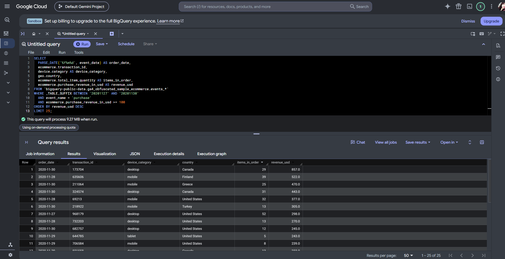
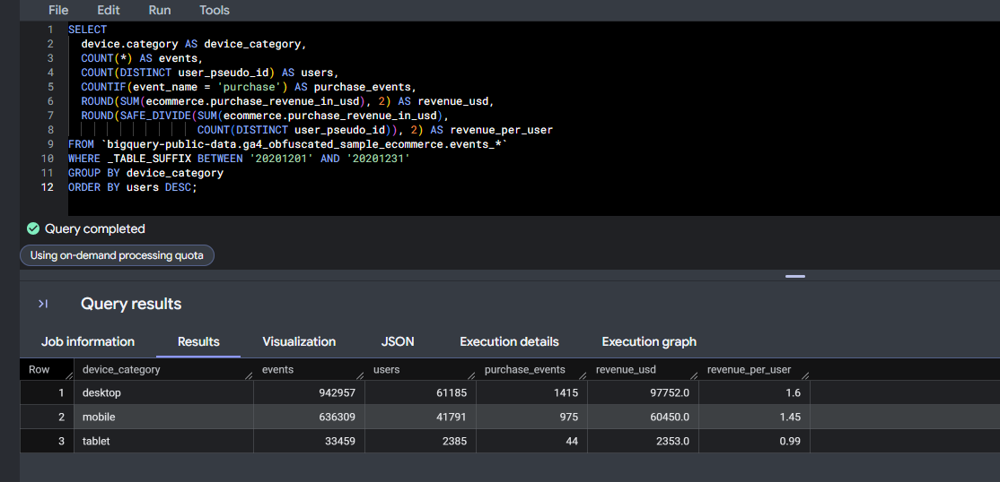
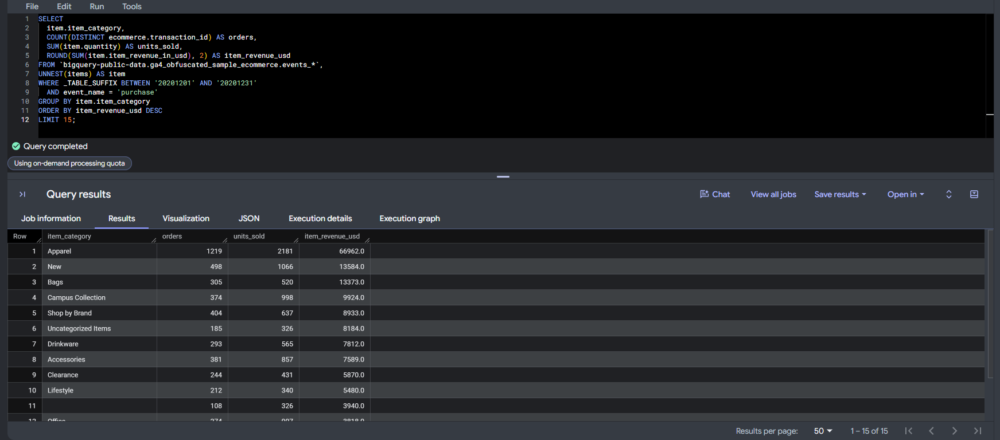
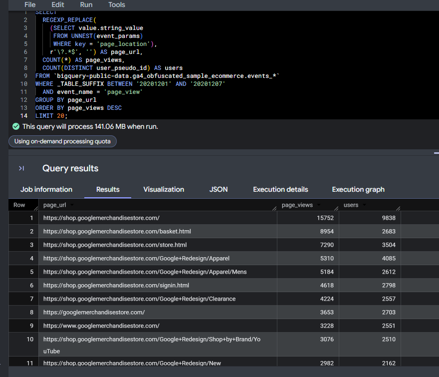
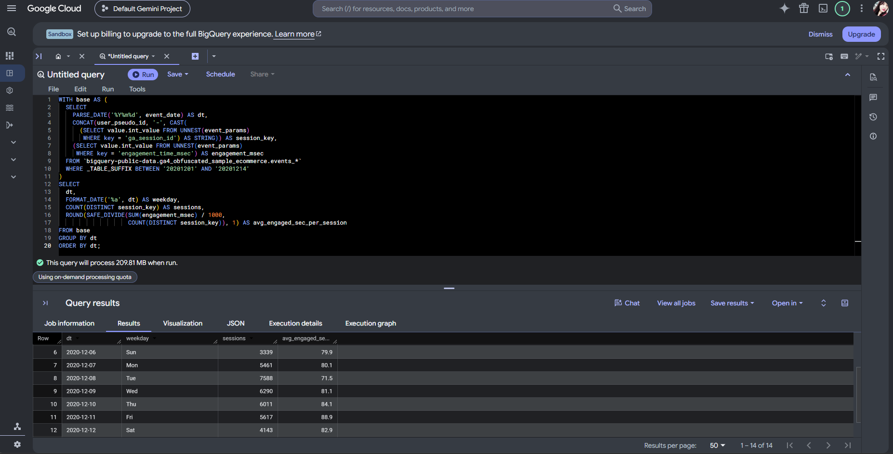
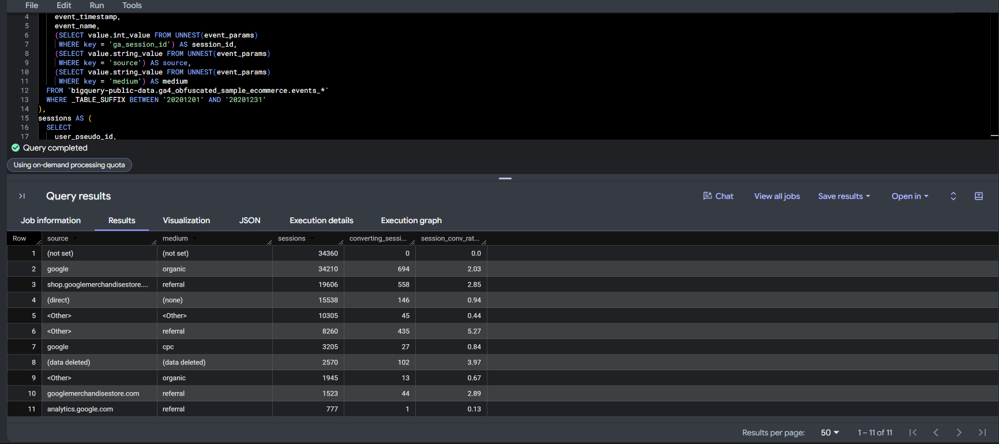
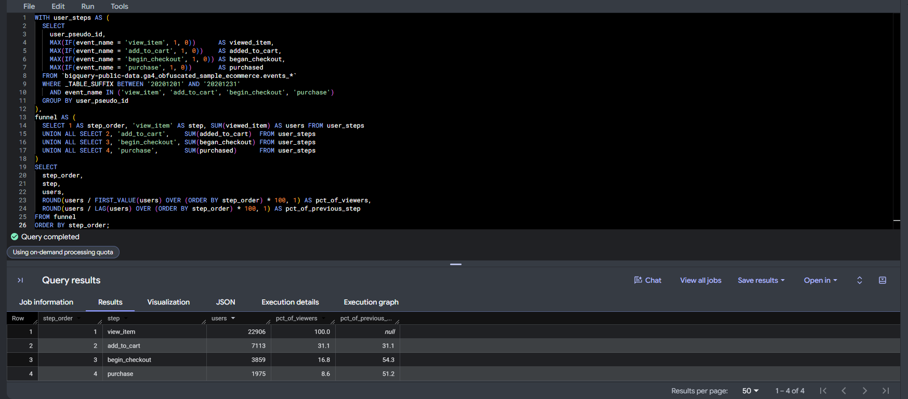
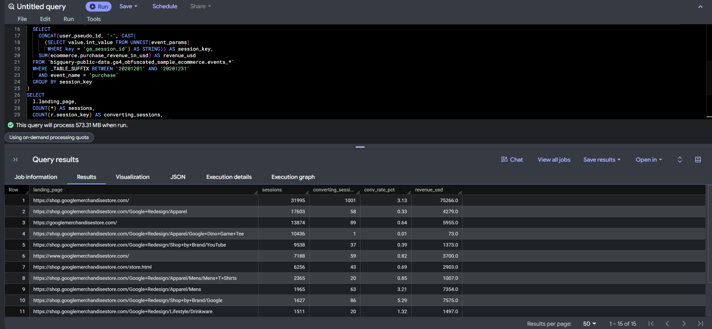

```{=html}
<style>

:root{--bs-body-font-family:Arial,Helvetica,sans-serif;--bs-body-font-size:1.125rem;--bs-body-color:#182b24;--bs-body-bg:#fff;--bs-link-color:#176349}
body, p, li, td, th, figcaption, .subtitle, .author, nav{font-family:Arial,Helvetica,sans-serif!important}
body{font-size:18px!important;line-height:1.75!important;background:#fff!important;color:#182b24!important}
p,li{font-weight:550}strong,b{font-weight:800!important;color:#164f38}
h1,h2,h3,h4,.title{font-family:Arial,Helvetica,sans-serif!important;font-weight:800!important;line-height:1.3!important;color:#174d38!important;letter-spacing:-.025em}
h1.title{font-size:40px!important}main h1:not(.title){font-size:29px!important;margin-top:2.8rem!important;padding:16px 0 14px;border-bottom:3px solid #dcebe2}h2{font-size:24px!important}h3{font-size:21px!important}
.subtitle{font-size:20px!important;font-weight:700!important}.quarto-title-meta{font-size:17px!important}
main{max-width:1100px}main p,main li{font-size:18px!important}main li{margin-bottom:12px}main li::marker{color:#26704d;font-weight:800}
pre,code{font-family:Consolas,'Liberation Mono',monospace!important}pre.sourceCode,div.sourceCode{background:#f4f7f5!important;border-radius:10px}div.sourceCode{border:1px solid #d9e4dd;border-left:5px solid #347753;padding:14px 18px;margin:24px 0!important}pre.sourceCode code{font-size:15px!important;line-height:1.65!important}pre>code.sourceCode>span{line-height:1.65!important}
figure,.quarto-figure{margin:30px 0!important}figure img, .quarto-figure img{display:block;width:100%;height:auto;border:1px solid #d3dfd7;border-radius:10px;box-shadow:0 5px 20px #153f2410}figcaption,.figure-caption{font-size:16px!important;font-weight:700!important;line-height:1.5;color:#3d5b4c!important;margin-top:12px!important}
table{font-size:17px!important}thead th{background:#e9f3ed!important;color:#174d38;font-weight:800!important}th,td{padding:13px 15px!important}tbody tr:nth-child(even){background:#f8faf9}
#TOC{font-size:15px!important;line-height:1.5}#TOC a{font-weight:650}a{font-weight:650;text-underline-offset:3px}
@media(max-width:767px){body,main p,main li{font-size:17px!important}h1.title{font-size:32px!important}main h1:not(.title){font-size:25px!important}div.sourceCode{padding:12px}pre.sourceCode code{font-size:13px!important}table{font-size:14px!important}}
@media print{body,main p,main li{font-size:11pt!important}main h1:not(.title){font-size:19pt!important;break-after:avoid}figure{break-inside:avoid}pre.sourceCode code{font-size:9pt!important}}

</style>
```

# Purpose and dataset

I used eight queries to explore how shoppers browsed products and made purchases during the 2020 holiday season. The questions cover order value, device use, engagement, and the steps between viewing an item and buying it.

**Dataset**

`bigquery-public-data.ga4_obfuscated_sample_ecommerce.events_*`

The queries use Google’s public GA4 ecommerce sample from the Google Merchandise Store. Each row represents one recorded event. Each query limits the daily tables it reads to the dates needed for its question.

| # | Query | Skills shown |
|---|-------|--------------|
| 1 | Biggest holiday orders | Filtering & scoping |
| 2 | Performance by device | Filtering, GROUP BY, COUNT, COUNT DISTINCT, SUM |
| 3 | Revenue by product category | GROUP BY, SUM, UNNEST(items) |
| 4 | Top pages | UNNEST(event_params), string_value |
| 5 | Daily sessions and engagement | UNNEST(event_params), int_value, CTE |
| 6 | Conversion by source / medium | CTEs, UNNEST string + int |
| 7 | Purchase funnel | Multiple CTEs combined with UNION ALL |
| 8 | Landing page to purchase | LEFT JOIN across CTEs |

# Query 1

**Skills shown: Filtering & scoping**

```sql
SELECT
  PARSE_DATE('%Y%m%d', event_date) AS order_date,
  ecommerce.transaction_id,
  device.category AS device_category,
  geo.country,
  ecommerce.total_item_quantity AS items_in_order,
  ecommerce.purchase_revenue_in_usd AS revenue_usd
FROM `bigquery-public-data.ga4_obfuscated_sample_ecommerce.events_*`
WHERE _TABLE_SUFFIX BETWEEN '20201127' AND '20201130'  -- BF to Cyber Monday only
  AND event_name = 'purchase'
  AND ecommerce.purchase_revenue_in_usd >= 100          -- high-value orders
ORDER BY revenue_usd DESC
LIMIT 25;
```



- **This query answers:** Which orders were the biggest during the Black Friday to Cyber Monday stretch?
- **It works by:** It filters to purchase events between Nov 27 and Nov 30 using `_TABLE_SUFFIX`, keeps orders of $100 or more, and sorts by revenue.
- **What the output shows:** The top order was **$857** from Canada on Cyber Monday, and many of the big orders held 29 to 52 items, which looks more like bulk or corporate swag buying than one person shopping. Mobile shows up in the top three, so big orders aren't desktop-only. Because the date filter is tight, the query scanned only **9.27 MB**.
- **You'd use it when:** Spotting high-value or B2B-style buyers during a promo window, for example to build a VIP or bulk-order audience.
- **Caveat:** Revenue values in the obfuscated sample are scrambled, so they show patterns rather than Google's real sales.

# Query 2

**Skills shown: Filtering + grouping & aggregation**

```sql
SELECT
  device.category AS device_category,
  COUNT(*) AS events,                                   -- events, not users
  COUNT(DISTINCT user_pseudo_id) AS users,
  COUNTIF(event_name = 'purchase') AS purchase_events,
  ROUND(SUM(ecommerce.purchase_revenue_in_usd), 2) AS revenue_usd,
  ROUND(SAFE_DIVIDE(SUM(ecommerce.purchase_revenue_in_usd),
                    COUNT(DISTINCT user_pseudo_id)), 2) AS revenue_per_user
FROM `bigquery-public-data.ga4_obfuscated_sample_ecommerce.events_*`
WHERE _TABLE_SUFFIX BETWEEN '20201201' AND '20201231'
GROUP BY device_category
ORDER BY users DESC;
```



- **This query answers:** How do desktop, mobile and tablet compare on traffic and revenue?
- **It works by:** It groups December events by `device.category` and calculates events with `COUNT(*)`, users with `COUNT(DISTINCT user_pseudo_id)`, purchases with `COUNTIF`, and revenue with `SUM`.
- **What the output shows:** Desktop led with 61,185 users and **$97,752,** about **61%** of revenue. Mobile and desktop users converted at nearly the same rate (about 2.3 purchase events per 100 users), but desktop orders were bigger, roughly **$69** vs **$62,** so desktop earns more per user (**$1.60** vs **$1.45**). The purchase events total 2,434, which matches the December count from Lecture 1.
- **You'd use it when:** Deciding where to focus UX or ad spend by device.
- **Caveat:** `COUNT(*)` counts events, not people. A user who shopped on two devices is counted under both, so the user column can't be added up.

# Query 3

**Skills shown: Grouping & aggregation (item level)**

```sql
SELECT
  item.item_category,
  COUNT(DISTINCT ecommerce.transaction_id) AS orders,
  SUM(item.quantity) AS units_sold,
  ROUND(SUM(item.item_revenue_in_usd), 2) AS item_revenue_usd
FROM `bigquery-public-data.ga4_obfuscated_sample_ecommerce.events_*`,
UNNEST(items) AS item                                    -- grain: one row per item per order
WHERE _TABLE_SUFFIX BETWEEN '20201201' AND '20201231'
  AND event_name = 'purchase'
GROUP BY item.item_category
ORDER BY item_revenue_usd DESC
LIMIT 15;
```



- **This query answers:** Which product categories drove December revenue?
- **It works by:** It flattens the `items` array of each purchase with `UNNEST(items)`, so each product in an order becomes its own row, then groups by `item_category` to count orders, units and item revenue.
- **What the output shows:** Apparel dominated with **$66,962** from 1,219 orders, about **40%** of item revenue. Several categories are really site sections (New, Shop by Brand, Clearance, Uncategorized), and one row has a blank category, so the store's category tagging isn't a clean product taxonomy.
- **You'd use it when:** Merchandising and inventory planning, or choosing which categories to feature in holiday campaigns.
- **Caveat:** The grain changes to one row per item per order, so order counts across categories add up to more than the real number of orders.

# Query 4

**Skills shown: UNNEST event_params (string_value)**

```sql
SELECT
  REGEXP_REPLACE(
    (SELECT value.string_value
     FROM UNNEST(event_params)
     WHERE key = 'page_location'),
    r'\?.*$', '') AS page_url,                          -- drop query strings
  COUNT(*) AS page_views,
  COUNT(DISTINCT user_pseudo_id) AS users
FROM `bigquery-public-data.ga4_obfuscated_sample_ecommerce.events_*`
WHERE _TABLE_SUFFIX BETWEEN '20201201' AND '20201207'
  AND event_name = 'page_view'
GROUP BY page_url
ORDER BY page_views DESC
LIMIT 20;
```



- **This query answers:** Which pages got the most views?
- **It works by:** It filters to `page_view` events, pulls `page_location` from `event_params` with a scalar subquery reading `value.string_value`, strips query strings with `REGEXP_REPLACE`, and groups by the cleaned URL.
- **What the output shows:** The homepage led with 15,752 views from 9,838 users. basket.html had 8,954 views from only 2,683 users, about 3.3 views per person, so shoppers keep going back to their cart. That's a sign of hesitation before checkout. Apparel and Clearance pages also rank high, which lines up with Q3.
- **You'd use it when:** Content and merchandising reviews, or finding pages to prioritize for testing.
- **Caveat:** The homepage appears under three hostnames (shop., www., and the bare domain), so a real report should normalize hostnames before grouping.

# Query 5

**Skills shown: UNNEST event_params (int_value) + CTE**

```sql
WITH base AS (
  SELECT
    PARSE_DATE('%Y%m%d', event_date) AS dt,
    CONCAT(user_pseudo_id, '-', CAST(
      (SELECT value.int_value FROM UNNEST(event_params)
       WHERE key = 'ga_session_id') AS STRING)) AS session_key,
    (SELECT value.int_value FROM UNNEST(event_params)
     WHERE key = 'engagement_time_msec') AS engagement_msec
  FROM `bigquery-public-data.ga4_obfuscated_sample_ecommerce.events_*`
  WHERE _TABLE_SUFFIX BETWEEN '20201201' AND '20201214'
)
SELECT
  dt,
  FORMAT_DATE('%a', dt) AS weekday,
  COUNT(DISTINCT session_key) AS sessions,
  ROUND(SAFE_DIVIDE(SUM(engagement_msec) / 1000,
                    COUNT(DISTINCT session_key)), 1) AS avg_engaged_sec_per_session
FROM base
GROUP BY dt
ORDER BY dt;
```



- **This query answers:** How many sessions happened each day, and how engaged were they?
- **It works by:** A base CTE pulls two integer parameters, `ga_session_id` and `engagement_time_msec`, both using `value.int_value`. It builds a session key by joining the user ID and session ID, since a session ID alone isn't unique across users. The outer query counts distinct sessions and averages engaged seconds per session by day.
- **What the output shows:** Tuesday, Dec 8 had the most sessions (7,588) but the lowest engagement (71.5 sec), which points to a campaign or email push bringing in lighter traffic. Weekends had far fewer sessions (Sunday, Dec 6: 3,339) but engagement held around 80 sec. Friday, Dec 11 had the longest sessions at 88.9 sec.
- **You'd use it when:** Tracking traffic quality alongside traffic volume, especially after campaign sends.
- **Caveat:** Sessions that cross midnight get counted on both days, and `engagement_time_msec` is only attached to some events, so this is GA4's engagement estimate, not exact time on site.

# Query 6

**Skills shown: CTE structure + UNNEST (string + int)**

```sql
WITH events AS (
  SELECT
    user_pseudo_id,
    event_timestamp,
    event_name,
    (SELECT value.int_value FROM UNNEST(event_params)
     WHERE key = 'ga_session_id') AS session_id,
    (SELECT value.string_value FROM UNNEST(event_params)
     WHERE key = 'source') AS source,
    (SELECT value.string_value FROM UNNEST(event_params)
     WHERE key = 'medium') AS medium
  FROM `bigquery-public-data.ga4_obfuscated_sample_ecommerce.events_*`
  WHERE _TABLE_SUFFIX BETWEEN '20201201' AND '20201231'
),
sessions AS (
  SELECT
    user_pseudo_id,
    session_id,
    -- first source/medium pair seen in the session
    ARRAY_AGG(IF(source IS NULL, NULL, STRUCT(source, medium))
              IGNORE NULLS ORDER BY event_timestamp LIMIT 1)[SAFE_OFFSET(0)] AS traffic,
    COUNTIF(event_name = 'purchase') > 0 AS converted
  FROM events
  WHERE session_id IS NOT NULL
  GROUP BY user_pseudo_id, session_id
)
SELECT
  IFNULL(traffic.source, '(not set)') AS source,
  IFNULL(traffic.medium, '(not set)') AS medium,
  COUNT(*) AS sessions,
  COUNTIF(converted) AS converting_sessions,
  ROUND(COUNTIF(converted) / COUNT(*) * 100, 2) AS session_conv_rate_pct
FROM sessions
GROUP BY 1, 2
HAVING COUNT(*) >= 500
ORDER BY sessions DESC;
```



- **This query answers:** Which traffic sources bring sessions that convert?
- **It works by:** The first CTE pulls `ga_session_id` (int) plus `source` and `medium` (string) for every event. The second CTE rolls events up to one row per session, using `ARRAY_AGG ... ORDER BY event_timestamp LIMIT 1` to take the first source/medium pair seen in the session and flag whether it had a purchase. The final step groups sessions by source/medium.
- **What the output shows:** google / organic brought the most converting sessions (694, **2.03%**). <Other> / referral converted best at **5.27%**. google / cpc converted at only **0.84%**, worse than organic. The store also refers to itself (shop.googlemerchandisestore.com / referral), a classic GA4 self-referral issue that steals credit from real sources.
- **You'd use it when:** Channel reporting and budget decisions, and catching tracking problems like self-referrals.
- **Caveat:** 34,360 sessions came back (not set) with zero conversions. GA4 only attaches source and medium to some events, so these are session pieces where no event carried them, such as sessions that crossed midnight or the month boundary. Newer exports have a session-level traffic source field, but the 2020 sample doesn't include it.

# Query 7

**Skills shown: Combining with multiple CTEs**

```sql
WITH user_steps AS (
  SELECT
    user_pseudo_id,
    MAX(IF(event_name = 'view_item', 1, 0))      AS viewed_item,
    MAX(IF(event_name = 'add_to_cart', 1, 0))    AS added_to_cart,
    MAX(IF(event_name = 'begin_checkout', 1, 0)) AS began_checkout,
    MAX(IF(event_name = 'purchase', 1, 0))       AS purchased
  FROM `bigquery-public-data.ga4_obfuscated_sample_ecommerce.events_*`
  WHERE _TABLE_SUFFIX BETWEEN '20201201' AND '20201231'
    AND event_name IN ('view_item', 'add_to_cart', 'begin_checkout', 'purchase')
  GROUP BY user_pseudo_id
),
funnel AS (
  SELECT 1 AS step_order, 'view_item' AS step, SUM(viewed_item) AS users FROM user_steps
  UNION ALL SELECT 2, 'add_to_cart',    SUM(added_to_cart)  FROM user_steps
  UNION ALL SELECT 3, 'begin_checkout', SUM(began_checkout) FROM user_steps
  UNION ALL SELECT 4, 'purchase',       SUM(purchased)      FROM user_steps
)
SELECT
  step_order,
  step,
  users,
  ROUND(users / FIRST_VALUE(users) OVER (ORDER BY step_order) * 100, 1) AS pct_of_viewers,
  ROUND(users / LAG(users) OVER (ORDER BY step_order) * 100, 1) AS pct_of_previous_step
FROM funnel
ORDER BY step_order;
```



- **This query answers:** How many users reach each step from viewing an item to buying?
- **It works by:** The first CTE flags, for each user, whether they ever triggered each funnel event. The second CTE uses `UNION ALL` to stack the step totals into one table, and window functions (`FIRST_VALUE`, `LAG`) calculate the percentage of viewers and the step-to-step rate.
- **What the output shows:** Of 22,906 users who viewed an item, 7,113 added to cart (**31.1%**), 3,859 began checkout, and 1,975 purchased, so **8.6%** of viewers bought something overall. The biggest leak is view to cart, where **69%** drop off. After that, about half make it through each step. 1,975 buyers against 2,434 purchase events means some people bought more than once.
- **You'd use it when:** Finding where the biggest drop-off is, which here points to product pages rather than checkout.
- **Caveat:** This is a user-level funnel that doesn't enforce order, so a user counts at a step even if they skipped an earlier one. The `null` on the first row is expected, since there's no previous step.

# Query 8

**Skills shown: Join**

```sql
WITH landings AS (
  SELECT
    CONCAT(user_pseudo_id, '-', CAST(
      (SELECT value.int_value FROM UNNEST(event_params)
       WHERE key = 'ga_session_id') AS STRING)) AS session_key,
    ANY_VALUE(REGEXP_REPLACE(
      (SELECT value.string_value FROM UNNEST(event_params)
       WHERE key = 'page_location'),
      r'\?.*$', '')) AS landing_page
  FROM `bigquery-public-data.ga4_obfuscated_sample_ecommerce.events_*`
  WHERE _TABLE_SUFFIX BETWEEN '20201201' AND '20201231'
    AND event_name = 'session_start'
  GROUP BY session_key                                   -- one row per session
),
session_revenue AS (
  SELECT
    CONCAT(user_pseudo_id, '-', CAST(
      (SELECT value.int_value FROM UNNEST(event_params)
       WHERE key = 'ga_session_id') AS STRING)) AS session_key,
    SUM(ecommerce.purchase_revenue_in_usd) AS revenue_usd
  FROM `bigquery-public-data.ga4_obfuscated_sample_ecommerce.events_*`
  WHERE _TABLE_SUFFIX BETWEEN '20201201' AND '20201231'
    AND event_name = 'purchase'
  GROUP BY session_key
)
SELECT
  l.landing_page,
  COUNT(*) AS sessions,
  COUNT(r.session_key) AS converting_sessions,
  ROUND(COUNT(r.session_key) / COUNT(*) * 100, 2) AS conv_rate_pct,
  ROUND(IFNULL(SUM(r.revenue_usd), 0), 2) AS revenue_usd
FROM landings l
LEFT JOIN session_revenue r
  ON l.session_key = r.session_key
WHERE l.session_key IS NOT NULL
GROUP BY l.landing_page
HAVING COUNT(*) >= 300
ORDER BY sessions DESC
LIMIT 15;
```



- **This query answers:** Which landing pages lead to sessions that actually buy?
- **It works by:** One CTE takes the `page_location` from each session's `session_start` event as the landing page. A second CTE adds up purchase revenue per session. A `LEFT JOIN` on the session key keeps every session, including ones that didn't buy, so the conversion rate uses all sessions as the base.
- **What the output shows:** The homepage drove 31,995 sessions, **3.13%** conversion and **$75,266,** nearly half of December revenue. The Google Dino Game Tee page brought 10,436 landing sessions but only 1 sale, so lots of traffic with no intent to buy. Shop by Brand / Google converted best at **5.29%**.
- **You'd use it when:** Landing page optimization and deciding where to send paid traffic.
- **Caveat:** Revenue is credited to the page where the session started, not the page that sold the item. Sessions without a `session_start` event are left out.

# Reflection

The most useful part for me was seeing how the same data can answer different marketing questions. Counting page views tells me how often a page was opened, while counting users tells me how many distinct users reached it. The cart page made that difference clear because the same shopper could visit it several times. In future reports, I’ll check what each row represents before I interpret a number as a sign of customer behavior.

# Appendix: 

- [GitHub Repository](https://github.com/Simrank-DM/IBM6500-F26/tree/main/BigQuery-SQL/GA4-4-SQL-Pack)
- [SQL Pack ](https://simrank-dm.github.io/IBM6500-F26/BigQuery-SQL/GA4-4-SQL-Pack/IBM6500-M4-SQL-Pack-Kaur.html)
- [BigQuery SQL Lecture 1](https://simrank-dm.github.io/IBM6500-F26/BigQuery-SQL/Lecture%201/IBM6500-BigQuery-SQL-lecture1-Kaur.html)
- [BigQuery SQL Lecture 2](https://simrank-dm.github.io/IBM6500-F26/BigQuery-SQL/Lecture%202/IBM6500-BigQuery-SQL-lecture2-Kaur.html)
