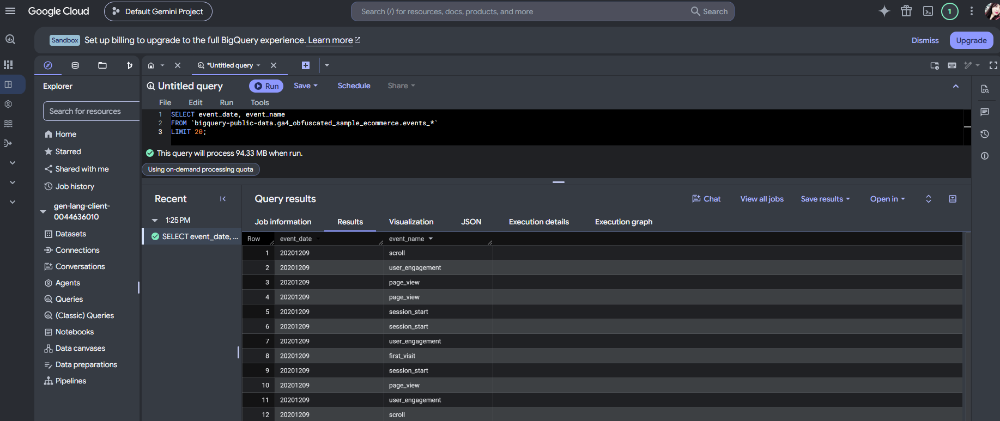
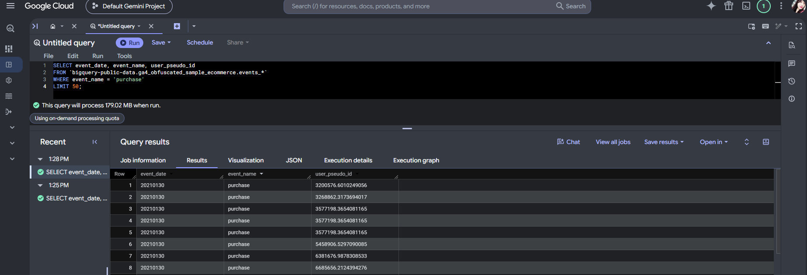
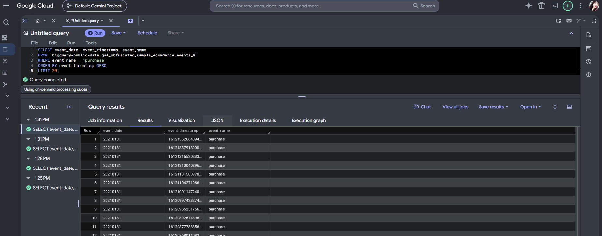
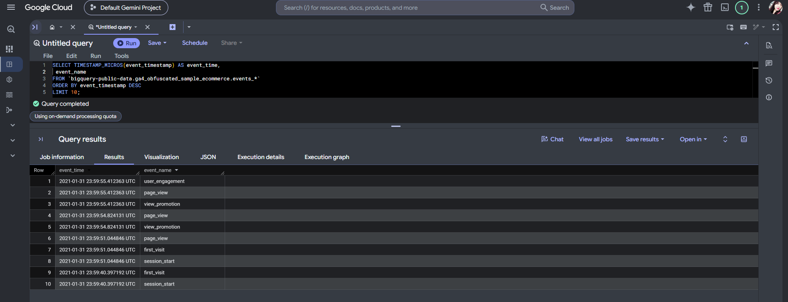
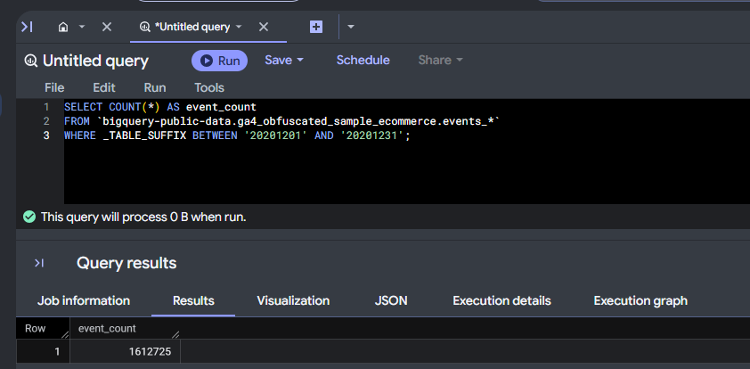
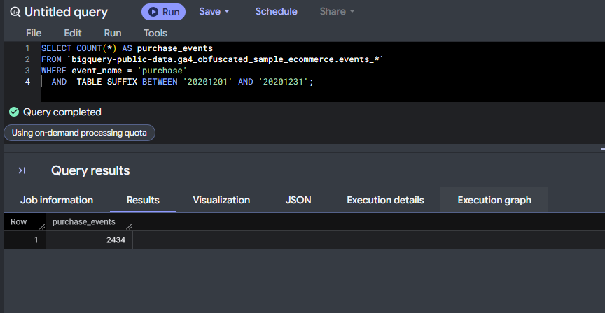
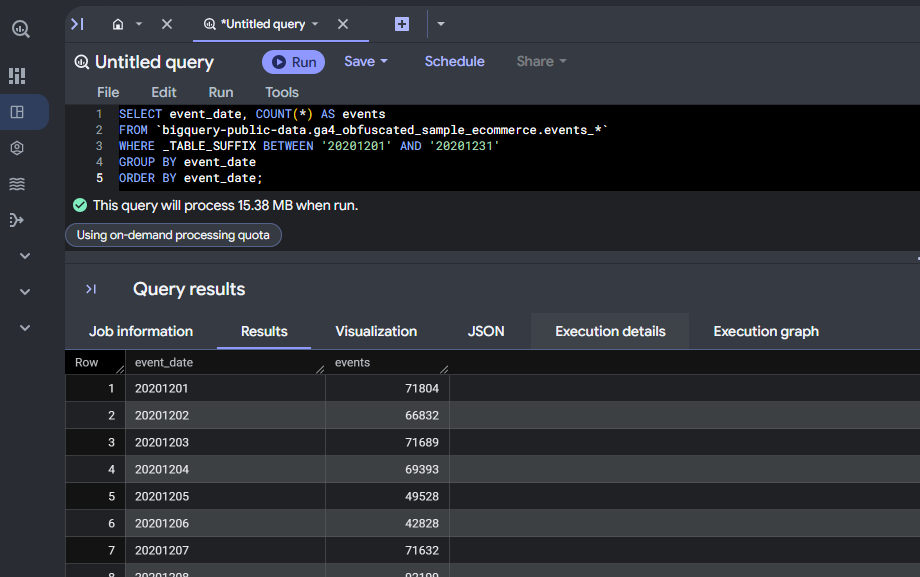
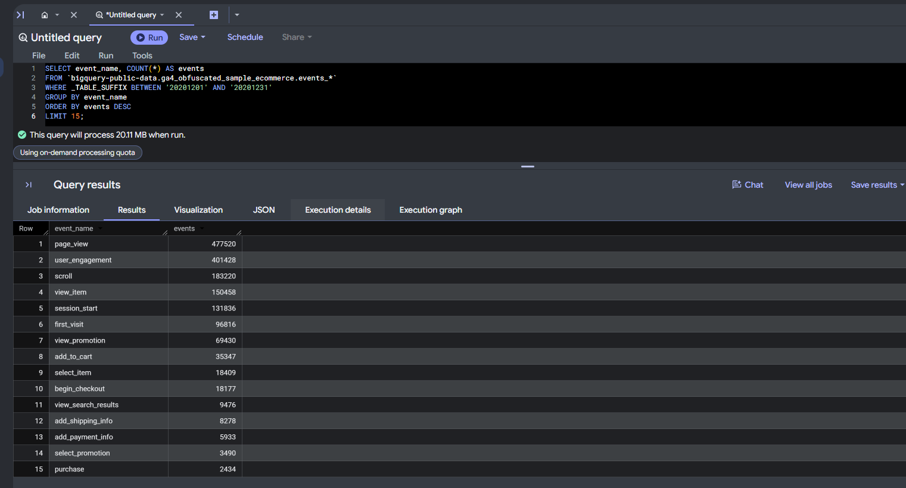
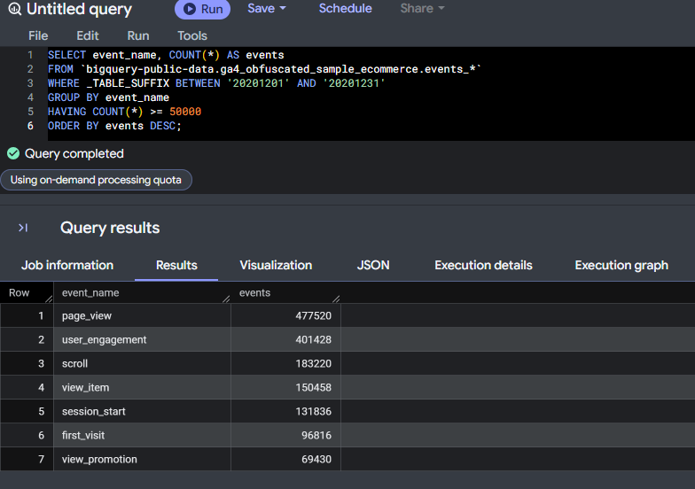
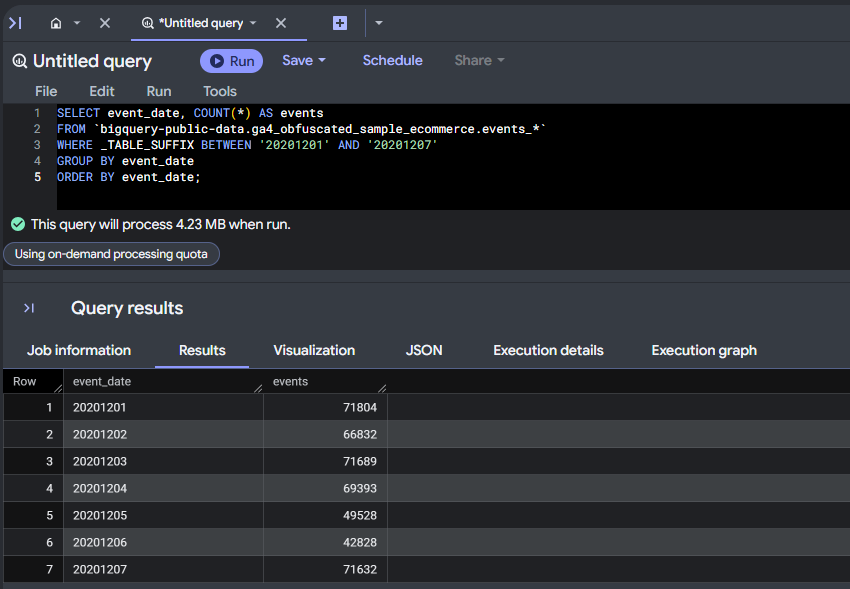

```{=html}
<style>
/* Matches the SQL Learning Portfolio palette. */
:root { --sql-green:#155b4f; --sql-pale:#f7faf8; --sql-border:#d9e6e0; }
body { color:#243c35; background:#fff; line-height:1.7; }
a { color:#155b4f; text-underline-offset:3px; }
a:hover { color:#103f37; }
a:focus-visible, button:focus-visible { outline:3px solid #b07822; outline-offset:4px; }
#title-block-header { background:#f7faf8; border:1px solid #d9e6e0; border-top:6px solid #155b4f; border-radius:12px; padding:2rem; margin-bottom:2.5rem; }
#title-block-header h1.title { color:#155b4f; font-weight:750; letter-spacing:-.035em; }
#title-block-header .subtitle { color:#526c61; font-size:1.05rem; }
h1,h2,h3 { color:#155b4f; }
main > section.level1 { margin-bottom:3rem; }
main > section.level1 > h1 { font-size:1.7rem; border-bottom:2px solid #d9e6e0; padding-bottom:.7rem; margin-top:2.4rem; }
h2 { font-size:1.3rem; }
#covered-in-lecture-1 { background:#f7faf8; border:1px solid #d9e6e0; border-radius:12px; padding:1.25rem; margin:1.75rem 0; overflow-x:auto; }
#covered-in-lecture-1 h2 { margin-top:0; }
table { width:100%; border-collapse:collapse; font-size:.95rem; }
thead th { background:#155b4f !important; color:white !important; padding:.75rem !important; border:0 !important; }
tbody td { padding:.75rem !important; border-bottom:1px solid #d9e6e0 !important; }
tbody tr:nth-child(even) td { background:#edf4ef; }
div.sourceCode { border:1px solid #d9e6e0; border-radius:12px; background:#f7faf8; }
pre.sourceCode { padding:1.1rem; }
p > code,td > code { color:#155b4f; background:#edf4ef; border-radius:4px; }
.quarto-figure img { border:1px solid #d9e6e0; border-radius:12px; }
.figure-caption { color:#60766b; font-size:.85rem; }
#reflection { background:#f7faf8; border:1px solid #d9e6e0; border-radius:12px; padding:1.5rem; }
#reflection > h1 { margin-top:0; }
#reflection strong { color:#155b4f; }
#TOC .nav-link.active { color:#155b4f !important; border-left-color:#155b4f !important; }
@media(max-width:600px) { #title-block-header {padding:1.3rem;} #covered-in-lecture-1 {padding:.8rem;} table {font-size:.85rem;} }
</style>
```

# Overview

These notes cover my practice from BigQuery SQL Lecture 1 using Google's public GA4 sample ecommerce dataset (`bigquery-public-data.ga4_obfuscated_sample_ecommerce`). I used the queries to practice selecting columns, filtering rows, sorting results, and summarizing events. The dataset contains obfuscated Google Merchandise Store event data from November 2020 to January 2021, with a separate table for each day.

## Covered in Lecture 1

| Topic | Quick recap |
|------------------------------------|------------------------------------|
| SELECT / FROM / LIMIT | Select columns, choose a table, and limit the rows shown. |
| WHERE | Filter rows using a condition. |
| ORDER BY | Sort results, such as showing the latest events first. |
| TIMESTAMP_MICROS() | Convert GA4 timestamps into a readable date and time. |
| COUNT(\*) | Count all events or a selected event type. |
| GROUP BY | Summarize events by date or event name. |
| HAVING | Filter grouped results based on their totals. |
| Wildcard tables and \_TABLE_SUFFIX | Select daily tables and narrow the date range scanned. |

# 1. SELECT / FROM / LIMIT

``` sql
SELECT event_date, event_name
FROM `bigquery-public-data.ga4_obfuscated_sample_ecommerce.events_*`
LIMIT 20;
```

**What it does:** This query selects the event date and event name and returns 20 rows. I can use `LIMIT` to take a quick look at the data before working on a larger query.

**What I noticed:** BigQuery showed 94.33 MB to be processed even though I only requested 20 rows. This helped me understand that `LIMIT` controls how many rows appear in the results, but does not necessarily reduce the data scanned. The results started with 20201209 because the order is not guaranteed without `ORDER BY`.



# 2. WHERE Filters Rows

``` sql
SELECT event_date, event_name, user_pseudo_id
FROM `bigquery-public-data.ga4_obfuscated_sample_ecommerce.events_*`
WHERE event_name = 'purchase'
LIMIT 50;
```

**What it does:** This query uses `WHERE` to keep only purchase events. It also includes `user_pseudo_id`, which helps identify activity associated with the same pseudonymous user ID.

**What I noticed:** Adding `user_pseudo_id` increased the data processed to about 179 MB. This reminded me to select only the columns I need. I also noticed repeated user IDs, so the number of purchase events is different from the number of unique purchasers.



# 3. ORDER BY Sorts Results

## 3a. Latest Purchases First

``` sql
SELECT event_date, event_timestamp, event_name
FROM `bigquery-public-data.ga4_obfuscated_sample_ecommerce.events_*`
WHERE event_name = 'purchase'
ORDER BY event_timestamp DESC
LIMIT 20;
```

**What it does:** This query sorts purchase events from newest to oldest using `ORDER BY event_timestamp DESC`. GA4 stores these timestamps as microseconds since January 1, 1970.

**What I noticed:** The latest purchases were from January 31, 2021, the last date in the dataset. The raw timestamp numbers were difficult to understand, so converting them into a readable date and time was helpful.



## 3b. Readable Timestamps

``` sql
SELECT TIMESTAMP_MICROS(event_timestamp) AS event_time,
       event_name
FROM `bigquery-public-data.ga4_obfuscated_sample_ecommerce.events_*`
ORDER BY event_timestamp DESC
LIMIT 10;
```

**What it does:** `TIMESTAMP_MICROS()` converts the timestamp into a readable date and time in UTC. I also corrected a missing space before `DESC` in the lecture query so it would run. Since this query has no date filter, it includes all matching daily tables.

**What I noticed:** The latest event shown was January 31, 2021, at 23:59:55 UTC. Some events had the same timestamp, such as `page_view` and `view_promotion`. This helped me see that multiple events can happen at the same time.



# 4. Aggregate Functions

## 4a. Total Events in December 2020

``` sql
SELECT COUNT(*) AS event_count
FROM `bigquery-public-data.ga4_obfuscated_sample_ecommerce.events_*`
WHERE _TABLE_SUFFIX BETWEEN '20201201' AND '20201231';
```

**What it does:** This query counts all event rows for December 2020. The `_TABLE_SUFFIX` filter limits it to the tables for that month.

**What I noticed:** The total was 1,612,725 events. BigQuery showed 0 B processed for this query, which can happen when a simple row count is answered using table metadata.



## 4b. Purchases in December 2020

``` sql
SELECT COUNT(*) AS purchase_events
FROM `bigquery-public-data.ga4_obfuscated_sample_ecommerce.events_*`
WHERE event_name = 'purchase'
  AND _TABLE_SUFFIX BETWEEN '20201201' AND '20201231';
```

**What it does:** This query counts only purchase events in December. I can compare it with the total event count to understand the share of events recorded as purchases.

**What I noticed:** There were 2,434 purchase events, or about 0.15% of all December events. This is the share of event rows that were purchases, rather than a user or session conversion rate.



# 5. GROUP BY Controls the Grain

## 5a. Events by Day

``` sql
SELECT event_date, COUNT(*) AS events
FROM `bigquery-public-data.ga4_obfuscated_sample_ecommerce.events_*`
WHERE _TABLE_SUFFIX BETWEEN '20201201' AND '20201231'
GROUP BY event_date
ORDER BY event_date;
```

**What it does:** `GROUP BY event_date` gives one row for each day, with the total number of events recorded that day. This makes daily activity easier to compare.

**What I noticed:** Some weekdays shown had around 67,000 to 72,000 events. December 5 and 6 had lower counts of about 49,500 and 42,800. Those two weekend days were quieter, but I would check the full month before describing it as a consistent weekend pattern.



## 5b. Top Event Types

``` sql
SELECT event_name, COUNT(*) AS events
FROM `bigquery-public-data.ga4_obfuscated_sample_ecommerce.events_*`
WHERE _TABLE_SUFFIX BETWEEN '20201201' AND '20201231'
GROUP BY event_name
ORDER BY events DESC
LIMIT 15;
```

**What it does:** This query groups events by name and shows the 15 most common event types. Sorting the counts in descending order makes it easier to see which activities happened most often.

**What I noticed:** `page_view` had the highest count at 477,520. The shopping events included 150,458 item views, 35,347 add-to-cart events, 18,177 checkout starts, 5,933 payment information events, and 2,434 purchases. These totals help compare activity across shopping steps, but they do not track the same users through a funnel. The purchase count also matched query 4b, which was a useful check.



# 6. HAVING Filters After Grouping

``` sql
SELECT event_name, COUNT(*) AS events
FROM `bigquery-public-data.ga4_obfuscated_sample_ecommerce.events_*`
WHERE _TABLE_SUFFIX BETWEEN '20201201' AND '20201231'
GROUP BY event_name
HAVING COUNT(*) >= 50000
ORDER BY events DESC;
```

**What it does:** `HAVING` keeps only event types with at least 50,000 events after grouping. The main difference I need to remember is that `WHERE` filters individual rows before grouping, while `HAVING` filters the grouped results.

**What I noticed:** Seven event types met the 50,000-event requirement, including `page_view` and `view_promotion`. Events such as `add_to_cart` and `purchase` were excluded because their totals were below the cutoff.



# 7. Wildcard Tables and \_TABLE_SUFFIX

``` sql
SELECT event_date, COUNT(*) AS events
FROM `bigquery-public-data.ga4_obfuscated_sample_ecommerce.events_*`
WHERE _TABLE_SUFFIX BETWEEN '20201201' AND '20201207'
GROUP BY event_date
ORDER BY event_date;
```

**What it does:** `events_*` matches the daily event tables, and `_TABLE_SUFFIX` refers to the part after `events_`. Here, the filter selects December 1–7 so the query only scans the tables needed for that week.

**What I noticed:** This query processed 4.23 MB compared with 15.38 MB for the full month, which is about 72% less data. The daily counts also matched the first week in query 5a. This showed me how a date filter can reduce the amount of data scanned while keeping the results relevant.



# Reflection

**Most useful skills.** The most useful part for me was applying SQL to GA4 event data. Breaking each query into smaller steps made it easier to understand what the results were showing. I can see myself using `WHERE`, `GROUP BY`, and `ORDER BY` regularly to compare activity by date or event type.

**Most challenging concepts.** I had to pay more attention to how GA4 stores its data, especially the separate daily tables and timestamps in microseconds. The difference between `WHERE` and `HAVING` also needed a little more thought because they filter at different stages of the query.

**What I want to remember.** Before running a query, I want to check the columns, date range, and amount of data being scanned. Using `_TABLE_SUFFIX` helped me narrow the query to the dates I needed. I also want to be careful when interpreting results, since event counts do not automatically represent unique users or conversion rates.

## Appendix Links

[**GitHub Repository**](https://github.com/Simrank-DM/IBM6500-F26/tree/main/BigQuery-SQL/Lecture%201)

[**Lecture 1 - HTML Report**](https://simrank-dm.github.io/IBM6500-F26/BigQuery-SQL/Lecture%201/IBM6500-BigQuery-SQL-lecture1-Kaur.html)

[**Lecture 1 - QMD File**](https://github.com/Simrank-DM/IBM6500-F26/blob/main/BigQuery-SQL/Lecture%201/IBM6500-BigQuery-SQL-lecture1-Kaur.qmd)

**Lecture 2:** Link coming soon.