```{=html}
<style>
/* Matches the SQL Learning Portfolio palette. */
:root { --sql-green:#155b4f; --sql-pale:#f7faf8; --sql-border:#d9e6e0; }
body { color:#243c35; background:#fff; line-height:1.7; }
a { color:#155b4f; text-underline-offset:3px; }
a:hover { color:#103f37; }
a:focus-visible, button:focus-visible { outline:3px solid #b07822; outline-offset:4px; }
#title-block-header { background:#f7faf8; border:1px solid #d9e6e0; border-top:6px solid #155b4f; border-radius:12px; padding:2rem; margin-bottom:2.5rem; }
#title-block-header h1.title { color:#155b4f; font-weight:750; letter-spacing:-.035em; }
#title-block-header .subtitle { color:#526c61; font-size:1.05rem; }
h1,h2,h3 { color:#155b4f; }
main > section.level1 { margin-bottom:3rem; }
main > section.level1 > h1 { font-size:1.7rem; border-bottom:2px solid #d9e6e0; padding-bottom:.7rem; margin-top:2.4rem; }
h2 { font-size:1.3rem; }
#covered-in-lecture-2 { background:#f7faf8; border:1px solid #d9e6e0; border-radius:12px; padding:1.25rem; margin:1.75rem 0; overflow-x:auto; }
#covered-in-lecture-2 h2 { margin-top:0; }
table { width:100%; border-collapse:collapse; font-size:.95rem; }
thead th { background:#155b4f !important; color:white !important; padding:.75rem !important; border:0 !important; }
tbody td { padding:.75rem !important; border-bottom:1px solid #d9e6e0 !important; }
tbody tr:nth-child(even) td { background:#edf4ef; }
div.sourceCode { border:1px solid #d9e6e0; border-radius:12px; background:#f7faf8; }
pre.sourceCode { padding:1.1rem; }
p > code,td > code { color:#155b4f; background:#edf4ef; border-radius:4px; }
.quarto-figure img { border:1px solid #d9e6e0; border-radius:12px; }
.figure-caption { color:#60766b; font-size:.85rem; }
#reflection { background:#f7faf8; border:1px solid #d9e6e0; border-radius:12px; padding:1.5rem; }
#reflection > h1 { margin-top:0; }
#reflection strong { color:#155b4f; }
#TOC .nav-link.active { color:#155b4f !important; border-left-color:#155b4f !important; }
@media(max-width:600px) { #title-block-header {padding:1.3rem;} #covered-in-lecture-2 {padding:.8rem;} table {font-size:.85rem;} }
</style>
```

# Overview

Lecture 1 covered the basics. This one gets into the parts that make GA4 data different: nested arrays like `event_params` and `items`, CTEs to break a query into steps, joins, and window functions. Everything still runs on Google's public GA4 sample (`bigquery-public-data.ga4_obfuscated_sample_ecommerce`), so there was nothing to upload.

## Covered in Lecture 2

| Topic | Quick recap |
|---|---|
| CTEs / WITH | Break longer queries into named steps. |
| Arrays / UNNEST | Extract parameters or create a row for each item. |
| STRING_AGG | Combine values into one text summary. |
| ARRAY_AGG / STRUCT | Collect related details into a nested list. |
| LEFT JOIN | Combine summaries while keeping all rows from the left side. |
| RANK / QUALIFY | Rank results within groups and filter those ranks. |
| Rolling averages | Smooth changes across several daily observations. |
| APPROX_COUNT_DISTINCT | Estimate unique users when an approximate count is suitable. |

# 1. CTEs (WITH) to Structure Logic

## Total Users and New Users

```sql
WITH UserInfo AS (
  SELECT
    user_pseudo_id,
    MAX(IF(event_name IN ('first_visit', 'first_open'), 1, 0)) AS is_new_user
  FROM `bigquery-public-data.ga4_obfuscated_sample_ecommerce.events_*`
  WHERE _TABLE_SUFFIX BETWEEN '20201101' AND '20201130'
  GROUP BY user_pseudo_id
)
SELECT
  COUNT(*) AS total_users,
  SUM(is_new_user) AS new_users
FROM UserInfo;
```

**What it does:** The CTE creates a temporary result with one row per user and a flag showing whether a first-visit or first-open event occurred in November. The final query counts those rows and adds the flags to count new users. Breaking this into two steps makes the logic easier for me to follow.

**What I noticed:** The query returned 79,421 user rows and 71,734 marked as new, or about 90%. This tells me that first-visit or first-open events were common in the selected period. I would not assume that this percentage is caused by November being the first month available in the dataset.

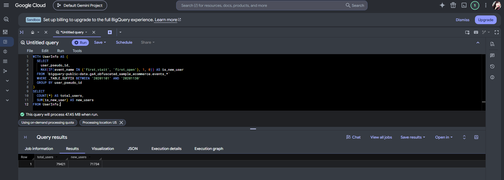

# 2. Arrays and UNNEST

## 2a. Pattern A: Scalar Subquery

```sql
SELECT
  TIMESTAMP_MICROS(event_timestamp) AS event_time,
  (
    SELECT value.string_value
    FROM UNNEST(event_params)
    WHERE key = 'page_location' LIMIT 1
  ) AS page_location
FROM `bigquery-public-data.ga4_obfuscated_sample_ecommerce.events_*`
WHERE event_name = 'page_view'
  AND _TABLE_SUFFIX BETWEEN '20201201' AND '20201202'
LIMIT 50;
```

**What it does:** `event_params` stores event details as an array of key/value pairs. This subquery uses `UNNEST` to find `page_location` and return it as a column. It keeps one row per event, which is useful when I only need one parameter.

**What I noticed:** The results included the homepage, product categories, a hoodie product page, registration, and the basket page. I also noticed URLs with and without the `shop.` prefix. These rows show different pages viewed, but they do not establish one person's journey through the store.

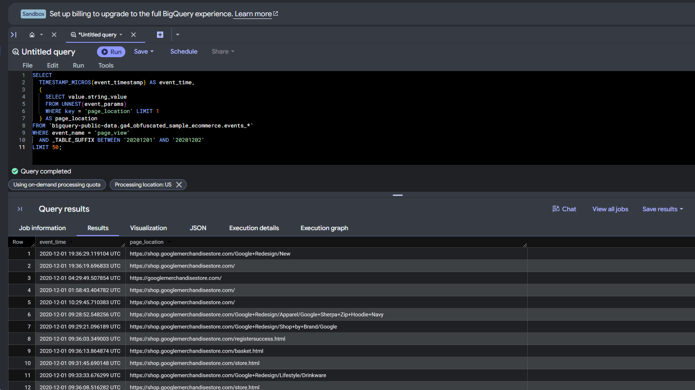

## 2b. Pattern B: Flattening Items

```sql
SELECT
  event_date,
  item.item_name,
  COUNT(*) AS item_rows
FROM `bigquery-public-data.ga4_obfuscated_sample_ecommerce.events_*` e,
UNNEST(e.items) AS item
WHERE e.event_name = 'purchase'
  AND _TABLE_SUFFIX BETWEEN '20201201' AND '20201231'
GROUP BY event_date, item.item_name
ORDER BY item_rows DESC
LIMIT 20;
```

**What it does:** Using `UNNEST(items)` in `FROM` gives each item entry in a purchase event its own row. One event containing three item entries can become three rows. I need to remember this change before interpreting the counts.

**What I noticed:** The $25 Gift Card had 28 item rows on December 10. The same mug appeared on different dates because the results group by both item name and day. There was also a `(not set)` item name. These counts represent item rows, rather than quantities sold or unique orders.

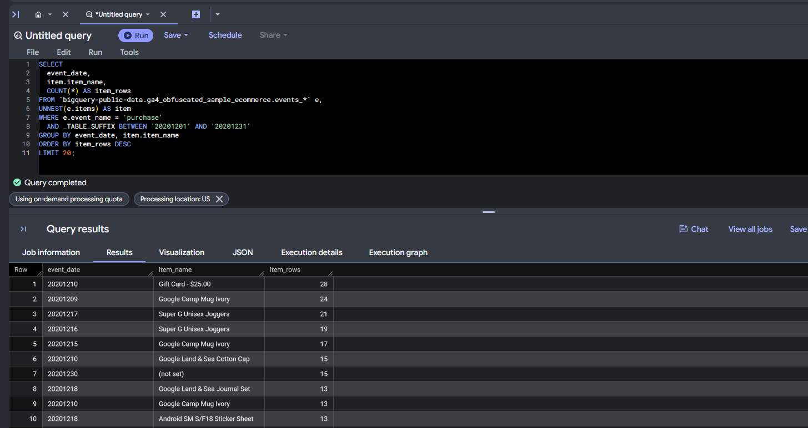

# 3. STRING_AGG and ARRAY_AGG

## 3a. Event Names Seen per Day

```sql
SELECT
  event_date,
  STRING_AGG(DISTINCT event_name, ', ' ORDER BY event_name) AS events_seen
FROM `bigquery-public-data.ga4_obfuscated_sample_ecommerce.events_*`
WHERE _TABLE_SUFFIX BETWEEN '20201201' AND '20201203'
GROUP BY event_date
ORDER BY event_date;
```

**What it does:** `STRING_AGG` combines the distinct event names for each day into one text value, separated by commas and sorted alphabetically. I also corrected `RDER BY` to `ORDER BY` in the lecture example.

**What I noticed:** The three days had similar event lists, but `view_item_list` appeared only on December 1 in the results. Keeping the names together in one row made this difference easier to notice.

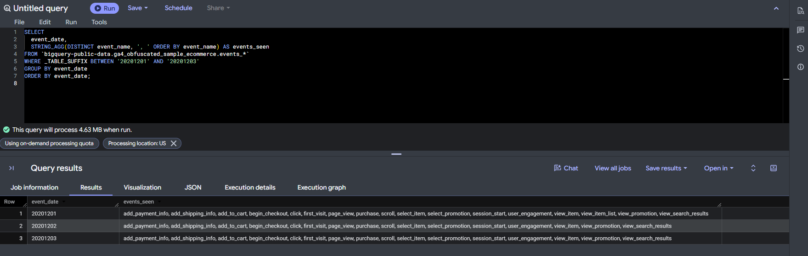

## 3b. ARRAY_AGG Use Case 1: Items Added to Cart per User

```sql
SELECT
  user_pseudo_id,
  ARRAY_AGG(item_name) AS items_added_to_cart
FROM `bigquery-public-data.ga4_obfuscated_sample_ecommerce.events_*`,
UNNEST(items) AS item
WHERE event_name = 'add_to_cart'
  AND _TABLE_SUFFIX BETWEEN '20201201' AND '20201231'
GROUP BY user_pseudo_id
ORDER BY user_pseudo_id
LIMIT 10;
```

**What it does:** This query separates the item entries from add-to-cart events and then uses `ARRAY_AGG` to collect their names into one list per user. This helps me summarize several rows without losing the item details.

**What I noticed:** One user's list included several kids' and youth products, while another included two campus stickers. Some names appeared more than once because the array keeps repeated item rows. Using `ARRAY_AGG(DISTINCT item_name)` would give a list of unique names instead.

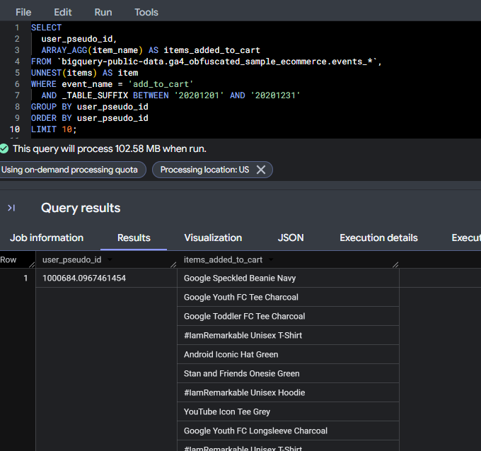

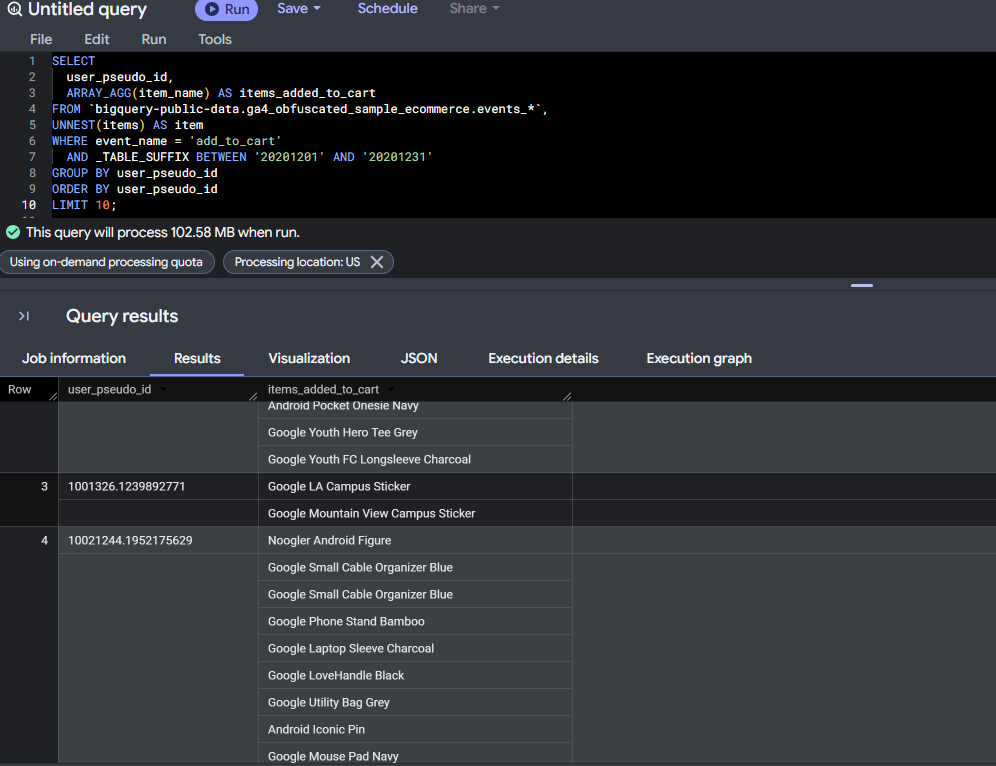

## 3c. ARRAY_AGG Use Case 2: Session Cart Summary

```sql
WITH add_to_cart AS (
  SELECT
    user_pseudo_id,
    (
      SELECT value.int_value
      FROM UNNEST(event_params)
      WHERE key = 'ga_session_id'
    ) AS session_id,
    TIMESTAMP_MICROS(event_timestamp) AS event_timestamp,
    i.item_id,
    i.item_name,
    i.quantity,
    i.price
  FROM `bigquery-public-data.ga4_obfuscated_sample_ecommerce.events_*`,
  UNNEST(items) AS i
  WHERE event_name = 'add_to_cart'
    AND _TABLE_SUFFIX BETWEEN '20210101' AND '20211231'  -- cost control
)
SELECT
  user_pseudo_id,
  session_id,
  COUNT(*) AS total_add_to_cart_events,
  ARRAY_AGG(
    STRUCT(item_id, item_name, quantity, price, event_timestamp)
    ORDER BY quantity DESC, event_timestamp ASC
    LIMIT 10
  ) AS cart_items
FROM add_to_cart
WHERE session_id IS NOT NULL
GROUP BY user_pseudo_id, session_id;
```

**What it does:** The CTE extracts the session ID and separates the item entries. The final query groups them by user and session and collects the item details into an array of structs. It keeps up to 10 entries, ordered by quantity and timestamp. This summarizes add-to-cart activity rather than reconstructing a final cart.

**What I noticed:** There were 4,537 user-session groups with add-to-cart activity. Although the filter covers 2021, the available data ends on January 31. I also need to be careful with `total_add_to_cart_events`: after `UNNEST`, this count measures item rows rather than distinct events. The 10-entry array limit does not limit that count.

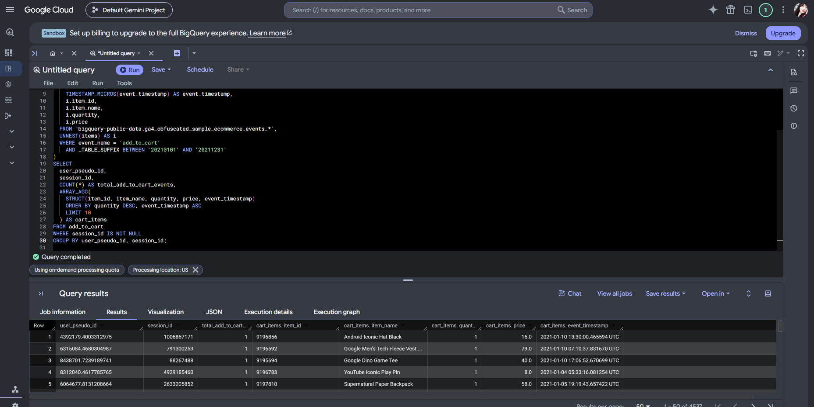

# 4. Joins

## Daily Users, Purchases, and Conversion Rate

```sql
WITH daily_users AS (
  SELECT
    event_date,
    COUNT(DISTINCT user_pseudo_id) AS users
  FROM `bigquery-public-data.ga4_obfuscated_sample_ecommerce.events_*`
  WHERE _TABLE_SUFFIX BETWEEN '20201201' AND '20201231'
  GROUP BY event_date
),
daily_purchases AS (
  SELECT
    event_date,
    COUNT(DISTINCT
      (SELECT value.string_value
       FROM UNNEST(event_params)
       WHERE key = 'transaction_id')
    ) AS purchases
  FROM `bigquery-public-data.ga4_obfuscated_sample_ecommerce.events_*`
  WHERE event_name = 'purchase'
    AND _TABLE_SUFFIX BETWEEN '20201201' AND '20201231'
  GROUP BY event_date
)
SELECT
  u.event_date,
  u.users,
  IFNULL(p.purchases, 0) AS purchases,
  ROUND(IFNULL(p.purchases, 0) / NULLIF(u.users, 0) * 100, 2) AS conversion_rate_pct
FROM daily_users u
LEFT JOIN daily_purchases p
  ON u.event_date = p.event_date
ORDER BY u.event_date;
```

**What it does:** Two CTEs summarize daily users and distinct transaction IDs. A `LEFT JOIN` combines them by date and keeps all days from the user summary. `IFNULL` replaces missing transaction totals with zero, while `NULLIF` protects the calculation from division by zero.

**What I noticed:** The calculated percentages shown were around 1.4% to 2.7%. December 5 had 3,082 users and a ratio of 2.73%, while December 6 had 1.39%. Although the query calls this `conversion_rate_pct`, it measures distinct transactions per user multiplied by 100, rather than the percentage of users who purchased. The query processed 531.64 MB, which also reminded me to check the scan size when working with nested parameters.

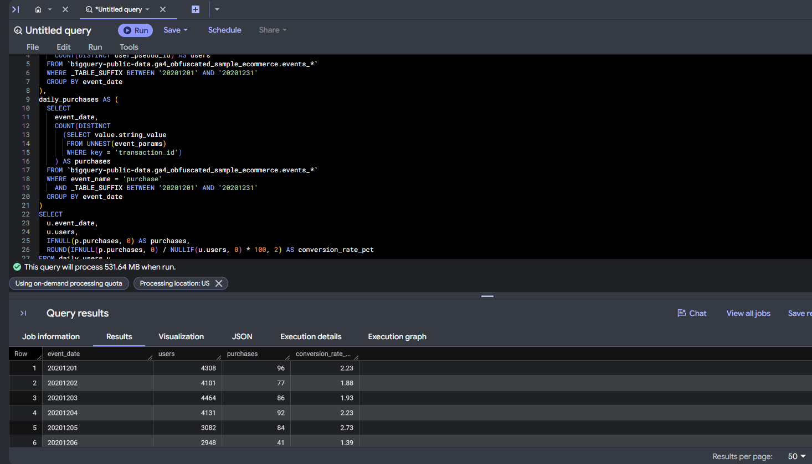

# 5. Window Functions and QUALIFY

## 5a. Top 3 Event Types per Day

```sql
WITH daily_event_counts AS (
  SELECT
    event_date,
    event_name,
    COUNT(*) AS events
  FROM `bigquery-public-data.ga4_obfuscated_sample_ecommerce.events_*`
  WHERE _TABLE_SUFFIX BETWEEN '20201201' AND '20201207'
  GROUP BY event_date, event_name
)
SELECT
  event_date,
  event_name,
  events,
  RANK() OVER (PARTITION BY event_date ORDER BY events DESC) AS rnk
FROM daily_event_counts
QUALIFY rnk <= 3
ORDER BY event_date, rnk;
```

**What it does:** `RANK()` ranks event types separately within each day. `QUALIFY` then filters the window-function results to ranks 1–3. This helps me compare the leading event types without writing a separate query for each date.

**What I noticed:** The query returned 21 rows, with `page_view`, `user_engagement`, and `scroll` leading each day. Their counts changed, but their order stayed the same. I also want to remember that tied ranks can produce more than three rows per day with `RANK()`.

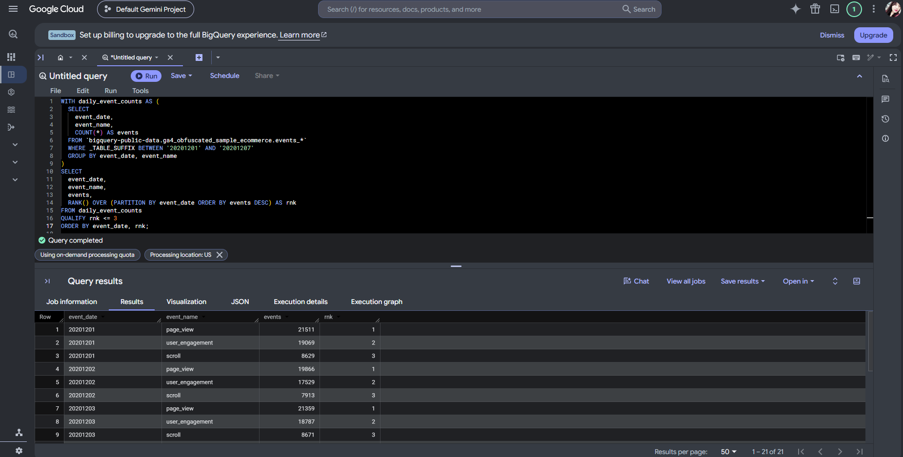

## 5b. Rolling 7-Day Average of Purchases

```sql
WITH daily_purchases AS (
  SELECT
    PARSE_DATE('%Y%m%d', event_date) AS dt,
    COUNT(*) AS purchases
  FROM `bigquery-public-data.ga4_obfuscated_sample_ecommerce.events_*`
  WHERE event_name = 'purchase'
    AND _TABLE_SUFFIX BETWEEN '20201201' AND '20201231'
  GROUP BY dt
)
SELECT
  dt,
  purchases,
  AVG(purchases) OVER (
    ORDER BY dt
    ROWS BETWEEN 6 PRECEDING AND CURRENT ROW
  ) AS purchases_7d_avg
FROM daily_purchases
ORDER BY dt;
```

**What it does:** `PARSE_DATE` converts the date text into a date value. The window averages the current row and the six preceding rows to smooth daily changes. This represents seven calendar days when the daily rows are consecutive; missing dates would need to be filled first.

**What I noticed:** The first six rows use fewer than seven observations because there is not enough earlier data. December 6 had 42 purchase events, while the rolling average was about 84. I also noticed 107 purchase events on December 1 compared with 96 distinct transactions in the join query. This showed me why I need to define what I am counting before comparing results.

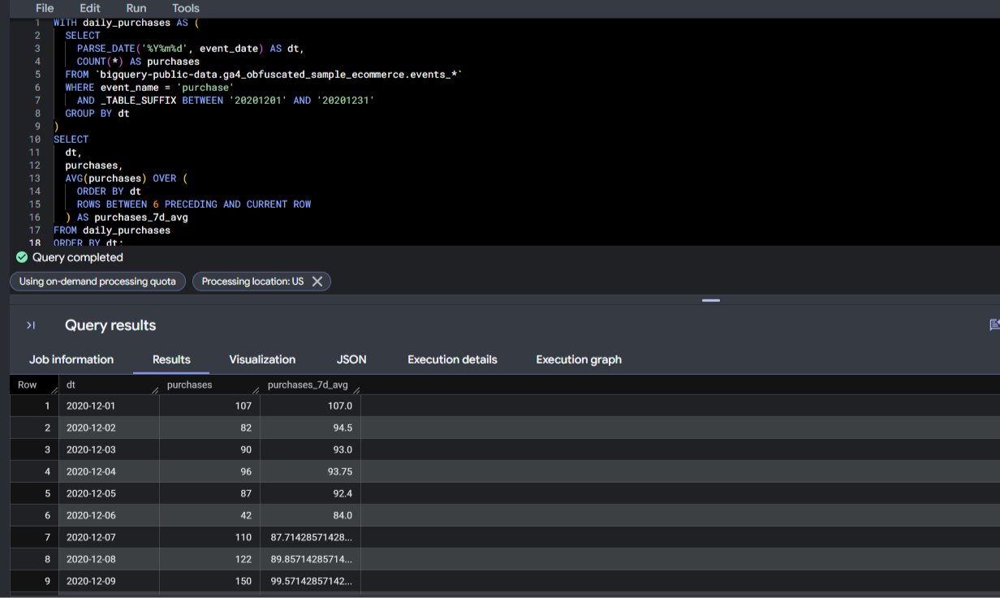

# 6. Approximate Functions

## Approx Distinct Users per Event Type

```sql
SELECT
  event_name,
  APPROX_COUNT_DISTINCT(user_pseudo_id) AS approx_users
FROM `bigquery-public-data.ga4_obfuscated_sample_ecommerce.events_*`
WHERE _TABLE_SUFFIX BETWEEN '20201201' AND '20201231'
GROUP BY event_name
ORDER BY approx_users DESC
LIMIT 15;
```

**What it does:** `APPROX_COUNT_DISTINCT` estimates the number of unique user IDs for each event type. It can reduce computation and memory use on large datasets, but the result is approximate. I would use an exact count when precision is required and check performance rather than assume fewer bytes will be scanned.

**What I noticed:** The estimate was about 104,837 users with page views. Compared with Lecture 1's 477,520 page-view events, that is roughly 4.6 views per estimated user. The results also showed about 7,109 users with add-to-cart activity and 3,855 with checkout starts. Those separate totals do not prove that the same users moved between the two steps.

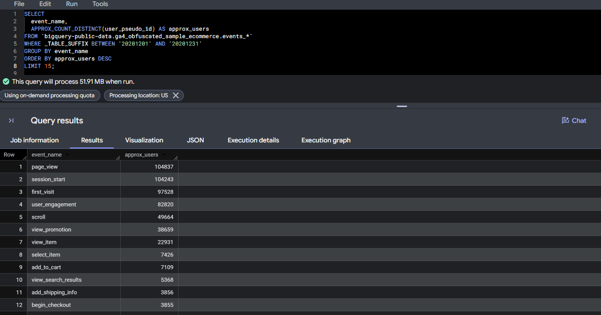

# Reflection

**Most useful skills.** The most useful part for me was learning how to break longer queries into smaller steps with CTEs. I also liked using ranking and rolling averages because I can see how they would help me compare activity and show trends in a marketing dashboard.

**Most challenging concepts.** Working with nested arrays needed the most attention. Extracting one parameter keeps the event rows, while flattening items can create several rows from one event. I had to keep checking what each row represented so I would not mistake item counts for event counts.

**What I want to remember.** Before interpreting a result, I want to check the date range, grouping, and definition of each metric. Purchase events, distinct transactions, and purchasing users can give different answers. I also want to keep using `_TABLE_SUFFIX` and checking the data scanned before running larger queries.

# Appendix

[GitHub Repository](https://github.com/Simrank-DM/IBM6500-F26/tree/main/BigQuery-SQL/Lecture%202)

[Lecture 2 - HTML Report](https://simrank-dm.github.io/IBM6500-F26/BigQuery-SQL/Lecture%202/IBM6500-BigQuery-SQL-lecture2-Kaur.html)

[Lecture 2 - QMD File](https://github.com/Simrank-DM/IBM6500-F26/blob/main/BigQuery-SQL/Lecture%202/IBM6500-BigQuery-SQL-lecture2-Kaur.qmd)

[Lecture 1 - HTML Report](https://simrank-dm.github.io/IBM6500-F26/BigQuery-SQL/Lecture%201/IBM6500-BigQuery-SQL-lecture1-Kaur.html)

[SQL Learning Portfolio](https://simrank-dm.github.io/IBM6500-F26/IBM6500-SQL/SQL-index.html)
