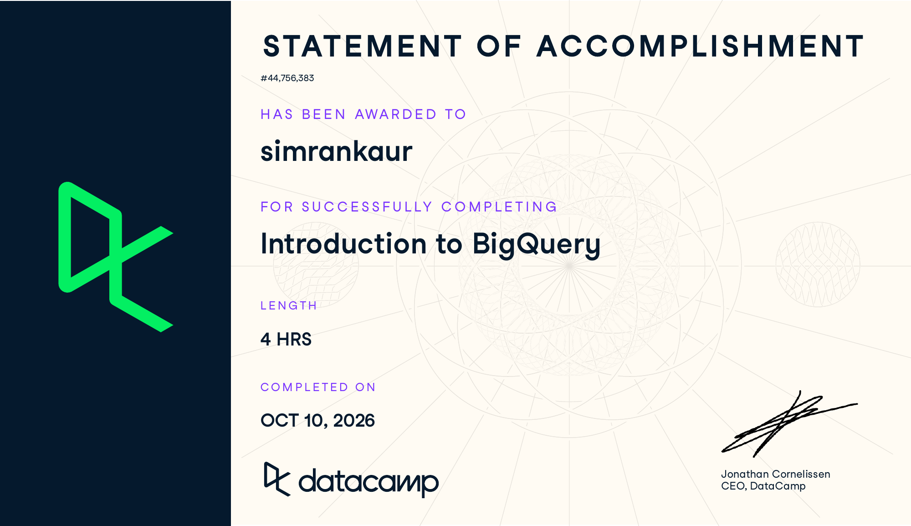
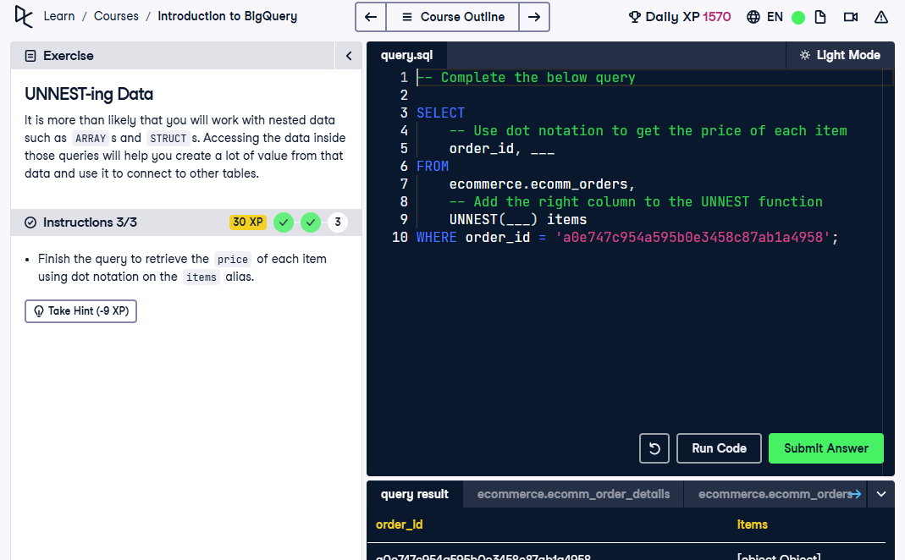
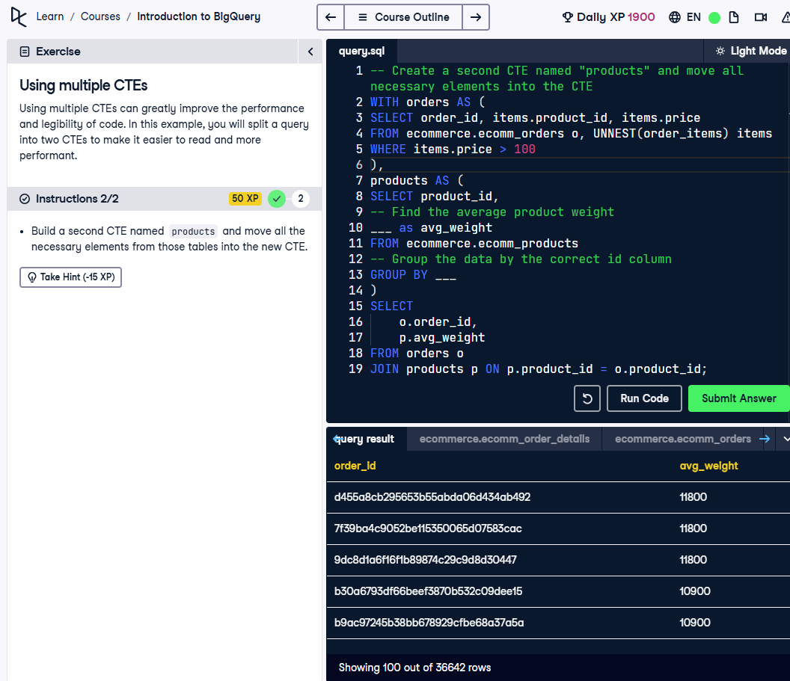
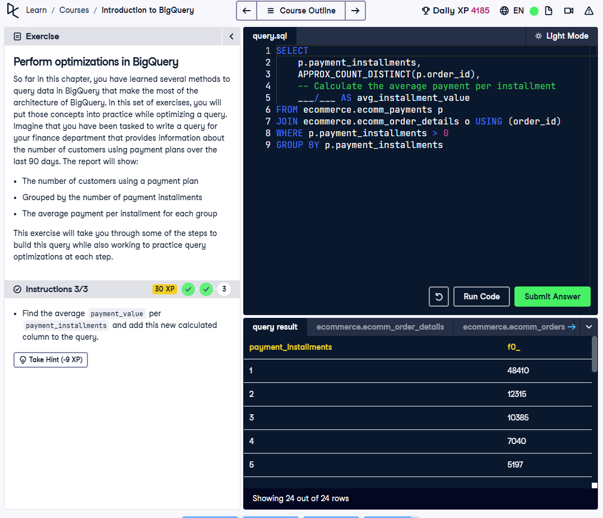

# Course Completion

I completed DataCamp’s **Introduction to BigQuery** on October 10, 2026. This course helped me build on what I learned in SQL and understand how to work with data in the cloud.



# My Learning Notes

## Understanding BigQuery

I learned that BigQuery helps analyze large datasets in the cloud. It organizes data into projects, datasets, and tables. Checking the schema first helps me understand the column names and data types before writing a query.

-   `USING (column)` is a shorter way to join tables with the same column name.

-   `INSERT` adds rows, `UPDATE` changes values, and `MERGE` combines actions.

-   `UPDATE` needs a `WHERE` clause in BigQuery.

-   Grouping changes together is more efficient than changing one row at a time.

-   Selecting fewer columns helps reduce the data scanned. `LIMIT` alone does not.

-   I can check the estimated bytes processed before running a query to avoid unnecessary costs.

-   **`COUNT()`:** Counts rows, such as `COUNT(*)` for the number of orders.

-   **`SUM()`:** Adds values, such as `SUM(payment_value)` for total payments.

-   **`AVG()`:** Finds an average, such as `AVG(price)` for average item price.

-   **`UNNEST()`:** Turns an array into rows, such as `UNNEST(order_items)`.

-   **`EXTRACT()`:** Gets part of a date, such as `EXTRACT(YEAR FROM order_purchase_timestamp)`.

-   **`COUNTIF()`:** Counts matching rows, such as `COUNTIF(order_status = 'delivered')`.

-   **`RANK()`:** Ranks results, such as `RANK() OVER (ORDER BY total_spent DESC)`.

## Working with Nested Data

Nested data was new to me. `UNNEST` turns a list into separate rows, and dot notation lets me select a field inside it. This took some practice, especially when keeping track of aliases.

``` sql
SELECT order_id, items.price
FROM ecommerce.ecomm_orders,
UNNEST(order_items) AS items;
```

An example from a DataCamp exercise gives each order item its own row and shows its price.



I can see myself using `UNNEST` outside class, especially when working with GA4 data to pull out details like page URLs. It could also help with survey answers where people select more than one option, if those answers are stored as a list.

## Making Queries Easier to Follow

CTEs stood out to me because they break a longer query into smaller steps using `WITH`. I also practiced grouping data and using window functions to rank results without combining all the rows. I will need to revisit window functions to feel more confident using them.



## Improving Queries

My main takeaway was to select only the columns I need. I also learned that adding `LIMIT` does not necessarily reduce the amount of data scanned. This made me think about efficiency as well as getting the correct result.



# My Reflection

The most useful parts were learning `UNNEST` and breaking queries into smaller steps with CTEs. Remembering the syntax and aliases was challenging, but the exercises helped me understand each step. I also learned how to filter data for a specific time frame. For example, adding `AND o.order_purchase_timestamp >= TIMESTAMP_SUB(CURRENT_TIMESTAMP(), INTERVAL 90 DAY)` to an existing `WHERE` condition would show data from the last 90 days.

For CEP, I could use these skills to organize survey responses and prepare brand-rating summaries for my AO2 analysis. BigQuery could help with data preparation before creating perceptual maps. I would still refer to my notes when working with nested data, dates, and window functions.

# Appendix: Publication Links

-   [GitHub Repository](https://github.com/Simrank-DM/IBM6500-F26/tree/main/IBM6500-SQL)
-   [Published Introduction to BigQuery Report](https://simrank-dm.github.io/IBM6500-F26/IBM6500-SQL/introduction-to-bigquery.html)