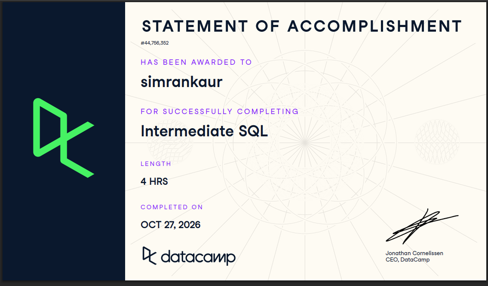
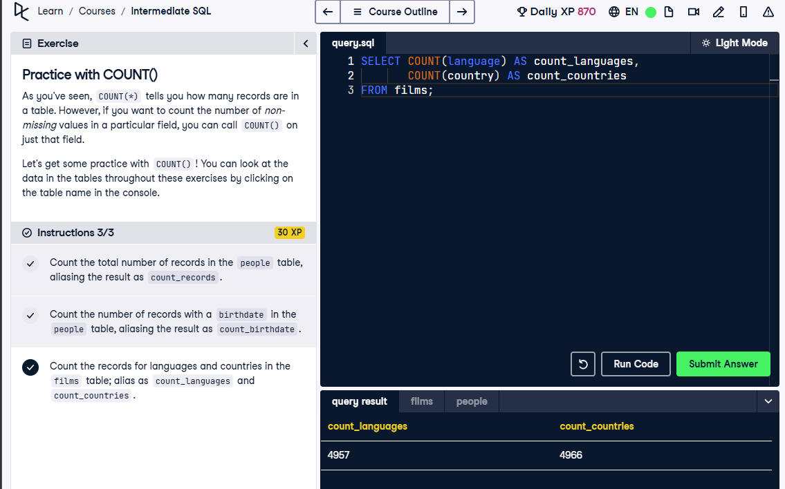
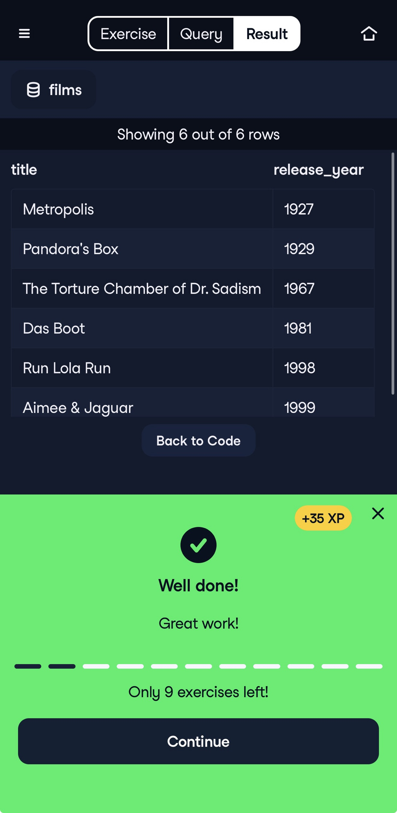
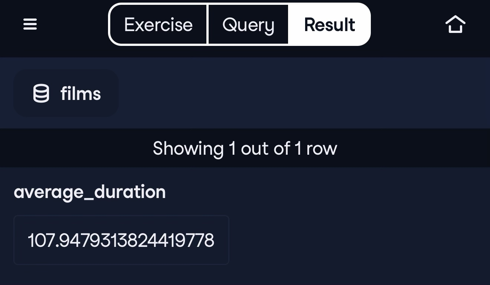
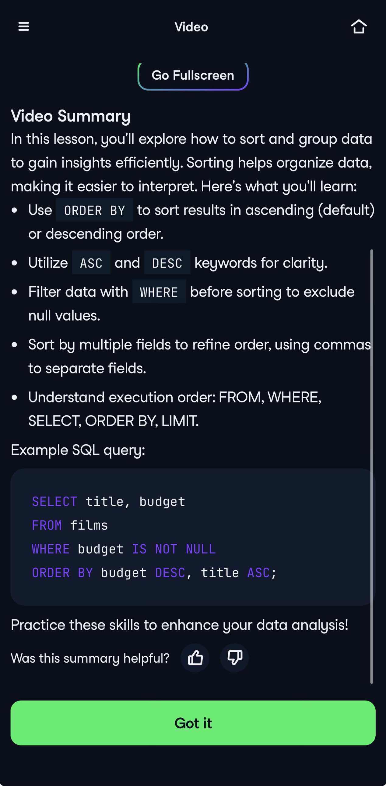

**Course:** IBM 6500\
**Assignment:** Intermediate SQL (DataCamp)

## Course Completion

I completed Intermediate SQL on October 27, 2026. The course used film data to teach and practice selecting, filtering, summarizing, and comparing records.

{width="85%"}

## Chapter 1: Selecting Data

I learned how to check the size and completeness of a dataset. `COUNT(*)` counts all rows, `COUNT(column)` skips missing values, and `COUNT(DISTINCT column)` counts unique values.

``` sql
SELECT COUNT(language) AS count_languages,
       COUNT(country) AS count_countries
FROM films;
```

This counts films with language and country information; it does not count unique languages or countries.

{width="85%"}

For a simple query, SQL processes `FROM`, then `SELECT`, then `LIMIT`. Clear formatting and correct column names make errors easier to find.

This chapter helped me see why checking the data comes before analyzing it. I also learned to read error messages and check spelling instead of rewriting the whole query.

## Chapter 2: Filtering Records

`WHERE` keeps rows that meet a condition. `AND` requires every condition to be true; `OR` requires at least one. I practiced `BETWEEN` for inclusive ranges, `IN` for lists, and `LIKE` for text patterns. Missing values need `IS NULL` or `IS NOT NULL`.

``` sql
SELECT title, release_year
FROM films
WHERE language = 'German'
  AND release_year < 2000;
```

This returns German-language films released before 2000.

{width="85%"}

Filtering made the queries feel more useful because I could focus on a specific question. Parentheses are a helpful reminder to check my logic when combining `AND` and `OR`.

## Chapter 3: Aggregate Functions

`SUM()`, `AVG()`, `MIN()`, and `MAX()` turn several values into a summary. `ROUND()` makes numerical results easier to present, while `AS` gives the result a clear name.

``` sql
SELECT ROUND(AVG(duration), 2) AS average_duration,
       MAX(release_year) AS latest_year
FROM films;
```

The screenshot shows the original average duration of about **107.95 minutes** before rounding. The query also finds the latest release year in the course dataset. When calculating ratios, using a decimal such as `100.0` helps avoid integer division in the course’s SQL environment.

{width="85%"}

I liked turning many records into one understandable result. The rounding exercises showed me that calculating a value and presenting it clearly are both important.

## Chapter 4: Sorting and Grouping

`ORDER BY` sorts results; `DESC` puts the highest values first. `GROUP BY` calculates a summary for each category. `WHERE` filters individual rows before grouping, while `HAVING` filters the groups afterward.

``` sql
SELECT country, COUNT(*) AS film_count
FROM films
WHERE country IS NOT NULL
GROUP BY country
HAVING COUNT(*) >= 10
ORDER BY film_count DESC;
```

This example ranks countries with at least 10 film records. It combines the chapter’s main ideas in one query.

{width="85%"}

Grouping was the most useful idea for comparing categories. I still need practice choosing between `WHERE` and `HAVING`, but thinking about whether I am filtering rows or groups helps.

## Overall Reflection 

**Most useful skills.** The most useful part for me was learning how to combine filtering, calculations, and grouping to answer specific questions. `WHERE` helps narrow the data, while functions like `COUNT()`, `AVG()`, and `SUM()` turn individual records into useful summaries. `GROUP BY` and `ORDER BY` also make comparisons easier.

**Most challenging concepts.** Understanding the difference between `WHERE` and `HAVING` took the most practice because one filters rows and the other filters grouped results. I also had to be careful when combining `AND` and `OR`. Small details, like missing values and integer division, showed me how a query can run but still give an unexpected answer.

**How SQL supports marketing analytics and the CEP.** These skills can help summarize marketing data by channel, time period, or customer group before bringing it into R. For our TBFI project on CALIPER-assisted meta-analysis, SQL could help check study IDs, find missing coding values, and compare record counts across outcome categories. These checks could also help me verify the counts and filters shown during my AO4 dashboard walkthrough.

**What I expect to review again.** I will probably review `WHERE` versus `HAVING`, query execution order, and how to combine aggregate functions with `GROUP BY`. I also want more practice calculating percentages and handling missing values. Keeping a few clear examples will help me apply these skills to new datasets.

## Connection to Our CEP Project

These skills could support our TBFI project on CALIPER-assisted meta-analysis if the secondary coding data were loaded into SQL tables:

-   **Selecting:** Count unique study IDs and effect-size records, and identify missing coding values.
-   **Filtering:** Select records by publication year or outcome construct.
-   **Summarizing:** Check record totals and numerical ranges for possible data issues.
-   **Grouping:** Compare record counts across constructs or study categories.

For my AO4 dashboard walkthrough, these checks could help verify that displayed counts and filters match the underlying data. SQL would support preparation and checking; pooled effects would still need appropriate meta-analysis methods.


# Appendix: Publication Links

- [GitHub Repository](https://github.com/Simrank-DM/IBM6500-F26/tree/main/IBM6500-SQL)
- [Introduction to SQL Report](https://simrank-dm.github.io/IBM6500-F26/IBM6500-SQL/Kaur-Simran-Introduction-to-SQL.html)
- [Introduction to BigQuery Report](https://simrank-dm.github.io/IBM6500-F26/IBM6500-SQL/BigQuery/introduction-to-bigquery.html)
- [SQL Learning Portfolio Landing Page](https://simrank-dm.github.io/IBM6500-F26/IBM6500-SQL/SQL-index.html)