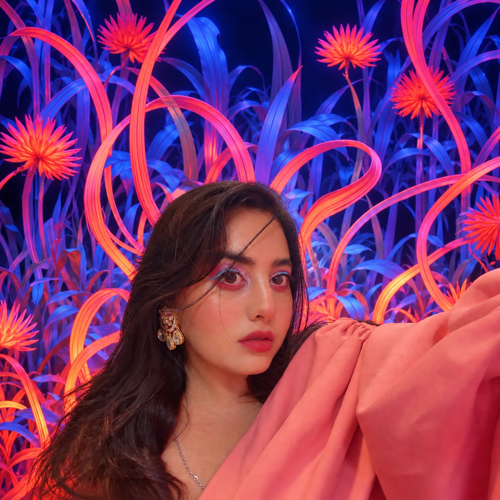

::: {.portfolio-hero}
::: {.hero-photo}
{.profile-photo}
:::
::: {.hero-intro}
::: {.eyebrow}
CREATIVITY · STRATEGY · ANALYTICS
:::

# Hi, I’m Simran.

::: {.hero-subtitle}
Bringing a creative perspective to marketing analytics.
:::

I’m a graduate student in **Digital Marketing and Analytics at Cal Poly Pomona**, with a background in graphic design and the apparel and fashion industry.

I’m interested in how brands connect with people—and how data can help make those connections more meaningful.

[Connect on LinkedIn](https://www.linkedin.com/in/simrank09/){.btn .btn-primary}
[Explore My GitHub](https://github.com/Simrank-DM){.btn .btn-outline-primary}

:::
:::

::: {.portfolio-section}
## About Me

My background brings together visual communication, fashion, and marketing. Through graphic design and social media strategy, I have developed an interest in understanding audiences and communicating ideas clearly.

I’m building on that creative foundation through graduate study in marketing analytics, exploring how data can support campaign evaluation, customer understanding, and business decisions.

### My Career Direction

My goal is to become a **marketing analyst in the fashion industry**, helping brands understand their customers, evaluate marketing performance, and turn insights into action.
:::

::: {.portfolio-section}
## What I Bring

::: {.skills-grid}
::: {.skill-card}
### Marketing & Strategy

- Social media marketing strategy
- Marketing campaign management
- Market and audience analysis
- Campaign planning
:::
::: {.skill-card}
### Analytics & Insights

- Google Analytics
- Performance dashboards
- Data visualization
- Marketing performance evaluation
:::
::: {.skill-card}
### Design & Storytelling

- Adobe Creative Suite
- Graphic design and illustration
- Animation
- Textile and surface pattern design
:::
:::
:::

::: {.portfolio-section}
## Experience

### Social Media Marketing Strategy
**Trauma Resource Institute · August–December 2025**

Developed a social media marketing strategy aligned with organizational objectives, analyzed opportunities for audience growth, and created a dashboard to track performance.

My work also included planning and executing a Giving Tuesday fundraising campaign to support donor engagement.

### Freelance Graphic Designer
**Self-employed · 2017–August 2026**

My professional background includes freelance graphic design and creative roles across the apparel and fashion industry.

### Additional Design Experience

My experience includes graphic design roles with **Formosi, Roxie + Harper, Dulce Bestia**, and **Iowa State University’s College of Design Dean’s Office–Student Affairs**.
:::

::: {.portfolio-section}
## Education

### Cal Poly Pomona
**M.S. in Digital Marketing and Analytics · In progress**

Graduate study focused on connecting marketing knowledge with analytical approaches to business questions.

### Iowa State University
**Bachelor’s Degree in Graphic Design · 2020**

A foundation in visual communication, creative thinking, and design.
:::

::: {.portfolio-section}
## Certifications & Learning

- Google Analytics Certification
- Dive Deeper Into GA4 Data and Reports
- Introduction to SQL
- Introduction to BigQuery
- Deloitte Future of Work Institute
:::

::: {.portfolio-section .contact-section}
## Let’s Connect

I’m interested in opportunities that bring together **marketing analytics, fashion, and creative storytelling**.

[Connect on LinkedIn](https://www.linkedin.com/in/simrank09/){.btn .btn-primary}
:::
