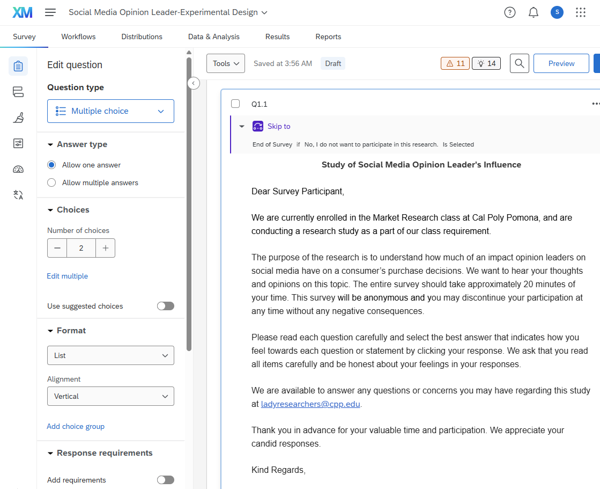
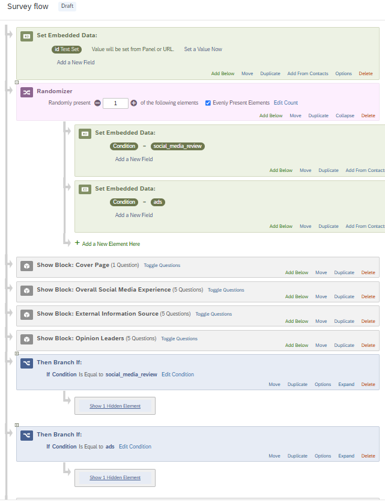
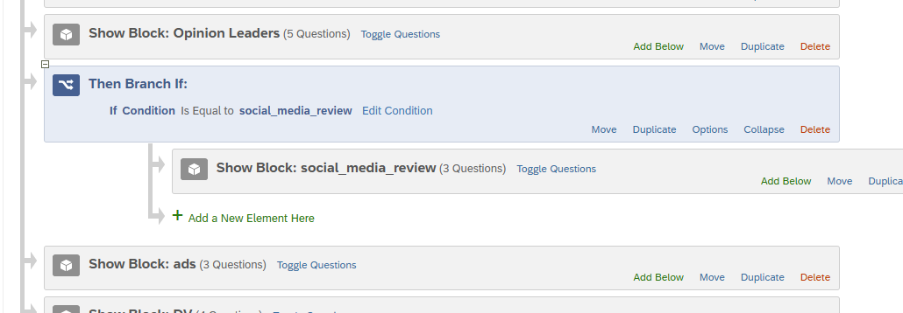
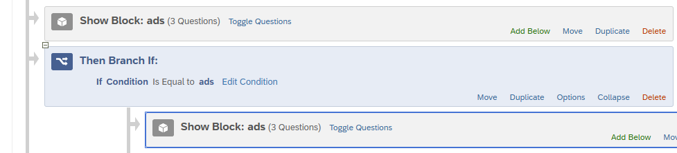
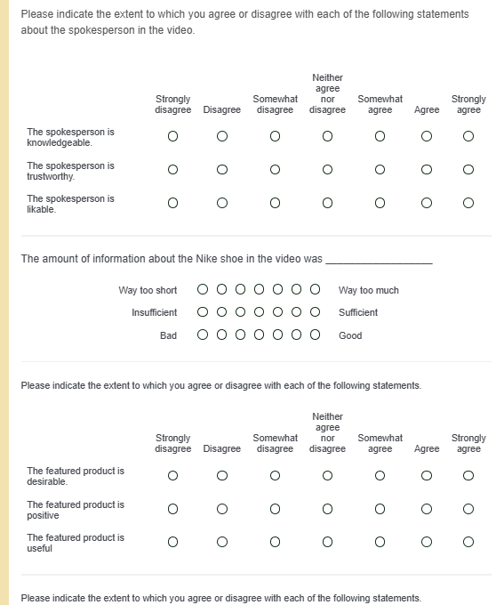
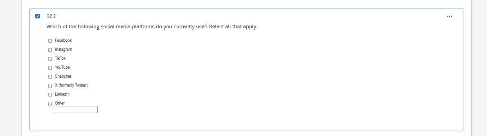
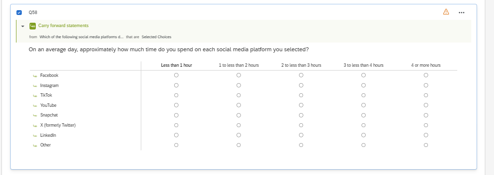
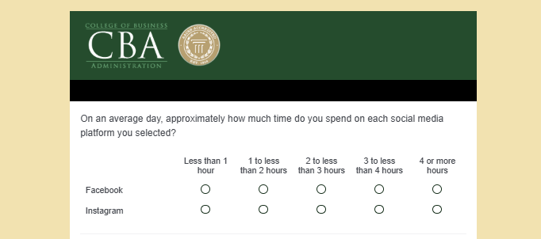

```{=html}
<style>
body { color: #26343d; }
h1, h2 { color: #174f40; }
figure { margin: 1.25rem 0 1.8rem; }
figcaption { color: #5a6871; font-size: 0.92rem; }
img { border: 1px solid #d6dfe3; border-radius: 5px; }
</style>
```

# Overview

For this assignment, I imported the provided QSF file into a separate project named **Social Media Opinion Leader-Experimental Design**. I then added the required experimental design, revised the social-media usage questions, and improved three other parts of the questionnaire.

{width="100%"}

# Experimental Design

I added a Randomizer after the existing `id` embedded-data element. It randomly presents **one** condition and evenly distributes participants between:

-   `Condition = social_media_review`
-   `Condition = ads`

{width="88%"}

I created two branches after the common survey blocks. The first branch shows the social-media review only when `Condition` equals `social_media_review`. The second shows the advertisement only when `Condition` equals `ads`.

{width="100%"}

{width="100%"}

The **DV block is outside and below both branches**, so every participant answers the same outcome questions after seeing only one stimulus. I previewed the survey and confirmed that the DV questions appeared after the assigned condition.

{width="78%"}

# Social-Media Usage and Carry Forward

I changed Q2.2 to ask which platforms participants currently use and enabled **Allow multiple answers**. The choices include Facebook, Instagram, TikTok, YouTube, Snapchat, X, LinkedIn, and Other. The Other choice includes text entry.

{width="100%"}

I added a Matrix Table question asking how much time participants spend on each selected platform. I used **Carry Forward Statements** from Q2.2 and placed a page break before the matrix. The time categories range from less than one hour to four or more hours.

{width="100%"}

I tested the function by selecting Facebook and Instagram. Only those two platforms appeared in the follow-up matrix, confirming that the Carry Forward setup worked correctly.

{width="78%"}

# Three Questionnaire Improvements

I made three additional improvements:

1.  **Q8.2:** I rewrote the traditional-advertising purchase-time question and changed its response categories so they do not overlap. I also added “I would not purchase it.”
2.  **Q8.4:** I replaced the mixed response labels with a consistent frequency scale: Never, Rarely, Sometimes, Often, and Very often.
3.  **Q9.4:** I corrected the wording to “What is your race or ethnicity?” and changed “Others” to “Other (please specify)” with text entry.

These changes made the questions clearer, easier to answer, and easier to analyze.

# Reflection

This assignment helped me understand a little more about the complex survey design. The most challenging part was placing the blocks correctly inside the branches without changing the rest of the survey. Testing the survey helped me see how the Randomizer, embedded data, branch logic, page breaks, and Carry Forward function work together. I also learned that small wording and scale problems can affect the quality of the data.

# Appendix: Links

-   [GitHub Repository](https://github.com/Simrank-DM/IBM6500-F26)
-   [Published HTML Report](https://simrank-dm.github.io/IBM6500-F26/Qualtrics-M01-1/Qualtrics-M02-Experimental-Design.html)
-   [Qualtrics Survey](https://cpp.az1.qualtrics.com/jfe/form/SV_88nu9SxxkFubxOu)